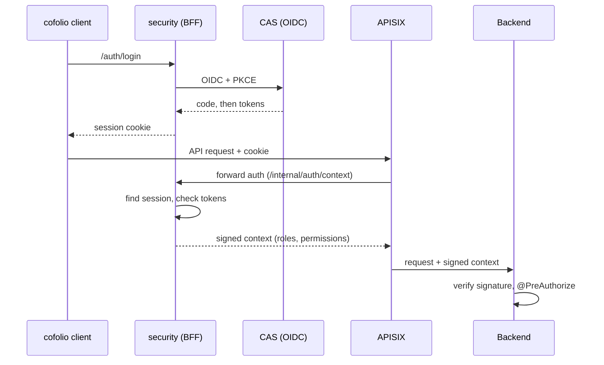

Authentication relies on a **BFF** (backend for frontend) implemented by `avenirs-portfolio-security`: the client only holds a session cookie, and the gateway turns it into a signed context for the backends.

## Flow

| Step | Who | What |
|---|---|---|
| Login | security | OIDC authorization code flow with PKCE against CAS, session stored server side |
| Session | client | Only the session cookie (`__Host-AVENIRS_SESSION`); no token in the browser |
| Forward auth | APISIX → security | Retrieves the session, checks the tokens, returns a signed context |
| Authorization | backend | Verifies the signature, then `@PreAuthorize(hasAuthority)` on the signed permissions; no call to `security` |

## Authorization model

`avenirs-portfolio-security` also hosts the **RBAC** engine: Role, Permission, Action, Scope, Context and Assignment.

## Going further

- [OIDC integration with CAS](../arch-soft-specif-security-oidc/)
- [RBAC levels](../arch-soft-specif-security-rbac-levels/)
- [Initial implementation (historical)](../initial-implementation)
