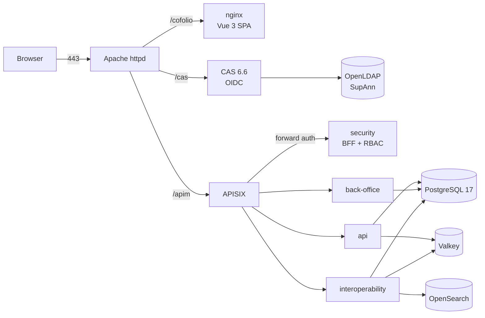
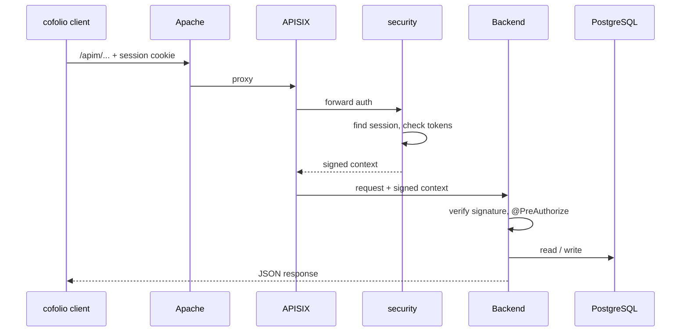
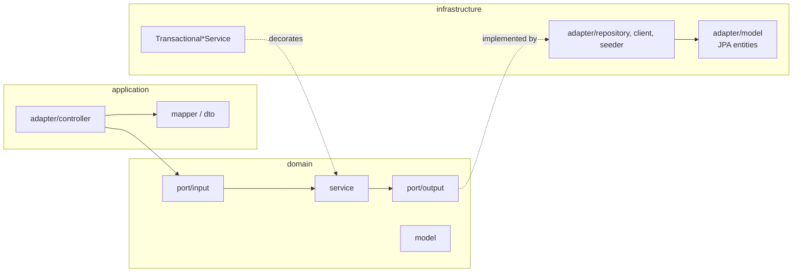

This page describes the architecture of the platform as deployed with Docker Compose (`srv-dev`, reused for qualif and recette). Detailed per-module architecture documents are in the [Software Architecture Specification](../arch-soft-specif-index/).

## Table of contents

- [Components](#components)
- [Request flow](#request-flow)
- [Java backends](#java-backends)
- [Data](#data)
- [Repositories](#repositories)

## Components

| Component | Role |
|---|---|
| Apache httpd | TLS entry point, path-based routing |
| nginx | Serves the `avenirs-cofolio-client` SPA under `/cofolio` |
| CAS 6.6 + OpenLDAP | OIDC authentication, directory in SupAnn format |
| APISIX | API gateway exposing the backends under `/apim`; routes are generated from the backends' OpenAPI (see [Development Environment](../srv-dev/)) |
| security | RBAC engine and OIDC BFF (see [Authentication](../authentication/)) |
| api / back-office / interoperability | Spring Boot backends, one PostgreSQL database each |

## Request flow

Public traffic goes through Apache, then APISIX. For every API call, APISIX asks `security` to resolve the session into a signed context, which the backend trusts.

- The gateway **identifies**; the backend **authorizes** locally with `@PreAuthorize(hasAuthority)` and does not call `security`.
- Every new endpoint needs an `operationId`: APISIX routes are generated from it.

## Java backends

The three backends (`avenirs-portfolio-api`, `-back-office`, `-interoperability`) share the `libs/avenirs-portfolio-common` library (Git submodule) and a hexagonal architecture, organized by business context:

| Service | Responsibility |
|---|---|
| api | ePortfolio business API (`/me/*` endpoints), file storage (S3) |
| back-office | Administration, directory search, access scopes |
| interoperability | Import of the ROME 4, CASOC/CASOL and XXI repositories, indexed in OpenSearch |

Conventions:

- **Domain imports are checked in CI**: the domain depends on neither infrastructure nor frameworks.
- **Transactions**: there is no `@Transactional` in domain services. Transactions are applied by infrastructure decorators named `Transactional*Service` (e.g. `TransactionalDeclaredActivityService`). A new service that writes to the database needs its own decorator.
- Domain services are wired by `*ServiceConfig` classes.
- One database per service (`avenirs_api`, `avenirs_back_office`, `avenirs_interoperability`), schema `dev`. Liquibase is **disabled at runtime**: migrations are applied separately (`npm run db:update-all` in srv-dev).
- Stack: Java 25, Spring Boot 4.1.

## Data

| Store | Usage |
|---|---|
| PostgreSQL 17 | One database per service |
| Valkey | Cache (api, interoperability) |
| OpenSearch | Repository indexes (interoperability) |
| Files | S3 (api): the only supported storage |

## Repositories

| Repository | Content |
|---|---|
| [srv-dev](https://github.com/avenirs-esr/srv-dev) | Docker Compose, overlays, bootstrap scripts, submodules ([details](../srv-dev/)) |
| avenirs-portfolio-api / -back-office / -interoperability / -security | Spring Boot backends |
| avenirs-cofolio-client | Vue 3 client (Vite, Pinia, TanStack Query, OpenAPI client generated by Orval) |
| [avenirs-deployment](https://github.com/avenirs-esr/avenirs-deployment) | Deployment scripts on the VMs ([details](../deployment/)) |
| [avenirs-workflows](https://github.com/avenirs-esr/avenirs-workflows) | Shared CI/CD ([details](../workflows/)) |
