> **Statut :** proposition à débattre<br/>
> **Date :** 9 novembre 2026<br/>
> **Synthèse :** [page principale de la RFC](../rfc-versionnement-historisation)

<h3>Sommaire</h3>

* TOC
{:toc}

## 1. Principes et architecture {#principes}

### 1.1 Principes de conception {#principes-conception}

1. **L'état courant ne change pas.** Il reste dans PostgreSQL, dans les tables métier actuelles. Le versionnement ajoute un historique à côté, sans changer la façon dont l'application lit et écrit l'état courant (HT1).
2. **Une version est un état complet et immuable.** On ne stocke pas de différences : comparer deux versions se calcule à la lecture. Éclaircir un historique revient à supprimer des versions, jamais à les fusionner (HT2).
3. **Les versions sont créées à la demande.** En phase 1, uniquement lors d'un gel. Un élément inchangé réutilise sa dernière version (même empreinte).
4. **Le caractère figé se déduit des gels.** Un gel a toujours un détenteur, un motif et une politique. Une capture peut avoir plusieurs gels ; elle ne devient purgeable que lorsque tous ont pris fin.
5. **Une capture référence, chaque version se suffit.** La capture pointe vers des versions d'éléments ; chaque version contient de quoi s'afficher seule (libellés, métadonnées de fichier), plus les identifiants utiles aux liens.
6. **Le code métier ne manipule pas d'anciens formats.** Il demande une capture et reçoit des objets du modèle courant ; convertir les anciens formats est l'affaire du module de versionnement (HT3).
7. **Le journal ne contient pas de contenu.** Il décrit l'action (qui, quoi, quand, sur quoi, dans quel contexte) et peut pointer vers une capture. Une entrée n'est jamais modifiée après écriture.
8. **Rien n'est supprimé tant qu'une référence persistante existe**, qu'il s'agisse d'une version ou d'un fichier. La purge est idempotente, relançable, et revérifie avant de supprimer.
9. **Restaurer crée un nouvel état courant.** L'historique n'est jamais réécrit (HF10).
10. **Chaque donnée a une finalité et une durée.** Preuve de ce qui a été transmis ou évalué, traçabilité des actions, statistiques : ce sont des finalités distinctes, avec des durées paramétrables et un effacement possible par personne.

### 1.2 Modules et ports {#modules}

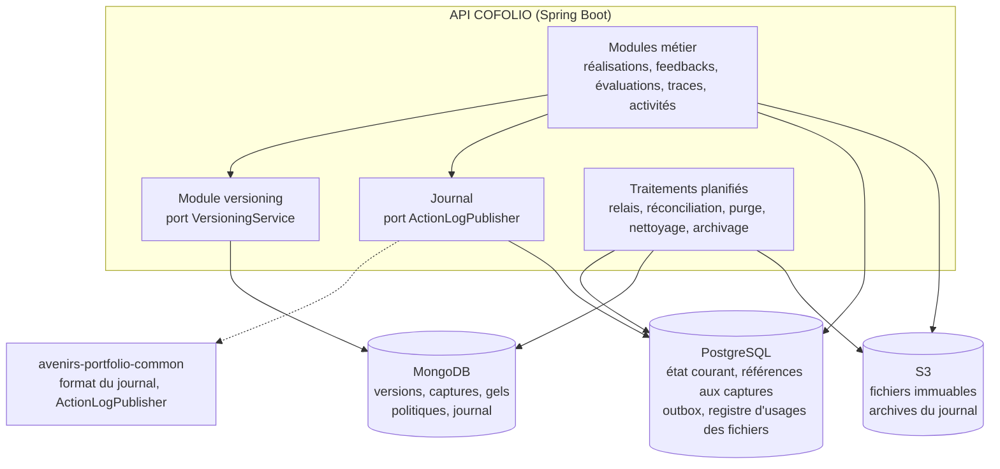

Le versionnement et le journal sont deux **modules de l'API**, déployés avec elle et organisés comme le reste du code. Les modules métier n'y accèdent que par deux ports ; seuls ces deux modules connaissent MongoDB. S'il le faut un jour (charge, mutualisation avec d'autres services), ils pourront devenir un service séparé sans toucher aux modules métier.

```java
public interface VersioningService {
  /** Crée la capture d'une réalisation et pose un gel PENDING au nom du détenteur. */
  CaptureRef capture(CaptureRequest request);

  /** Lit une capture : objets du modèle courant, quel que soit le format stocké. */
  CaptureView read(UUID captureId);

  /** Appelés par le relais outbox, après le commit de la transaction métier. */
  void confirmFreeze(UUID captureId, Holder holder);
  void releaseFreeze(UUID captureId, Holder holder, ReleaseReason reason);
  void onHolderDeleted(Holder holder, Instant deletedAt);

  /** Effacement RGPD de toutes les versions et captures d'une personne. */
  void eraseByOwnership(UUID ownerId);
}

public interface ActionLogPublisher {
  /** Inscrit l'entrée dans l'outbox ; exige une transaction en cours (propagation MANDATORY). */
  void publish(ActionLogEntry entry);
}
```

> **Pourquoi ?** Deux ports étroits isolent le métier du stockage : le choix de MongoDB (D1) reste réversible, et chaque module métier se teste séparément. Exiger une transaction en cours pour `publish` empêche de journaliser par erreur une action qui ne serait jamais validée.

## 2. Phase 1 : figer ce qui est transmis {#figer}

### 2.1 Rappel {#figer-besoin}

- **Besoins :**
  - [#988] : Une version créée à la soumission, conservée indépendamment des modifications ultérieures, évaluée sans modification rétroactive, à laquelle l'évaluation est rattachée ; plusieurs versions possibles "sans nécessiter une refonte importante".
  - [#2641] : Éléments transmis "au moment de l'envoi de la demande".
  - [#985] : Le STAFF consulte l'activité, ses sous-activités et leurs éléments associés d'après "le contenu conservé pour la soumission".
  - [#3046], [#3044] et [#2815] : Pour la suite de la V2.
- **Hypothèses :** HF1, HF2, HF3, HF5, HT1, HT2, HT3, HT5, HT7.
- **Constats :** C1, C2, C3, C4, C7, C11.

### 2.2 Ce qui est figé {#perimetre}

Une capture contient, tel qu'il est au moment de l'action, tout ce que l'utilisateur doit pouvoir consulter ([#985], [#2641]) :

| Élément | Type | Contenu de la version | Remarques |
| --- | --- | --- | --- |
| **Réalisation** (`DECLARED_ACTIVITY`) | structuré | dates de début et de fin, `startedAt`, `finishedAt`, `submittedAt`, `valorized`, statut calculé au moment de la capture, identifiants de l'activité et de l'apprenant | Le bilan est versionné à part |
| **Bilan réflexif** (`REFLECTION`) | texte riche | HTML tel qu'enregistré, produit par l'éditeur WYSIWYG (Tiptap) | Ressource à part entière (voir ci-dessous) |
| **Trace** (`TRACE`) | structuré | titre, langue, type d'auteur, justification de l'usage d'IA, note personnelle, lien, pièce jointe (identifiant, nom, type, taille, empreinte) | Le fichier reste dans S3 ([§4](#fichiers)) |
| **Compétence déclarée** (`SKILL_PROGRESS`) | structuré | compétence (identifiant, code, libellé, référentiel), niveau, réflexion (texte riche), valorisation | Libellé copié : la synchronisation nocturne du référentiel (C11) ne change pas ce qui a été transmis |
| **Expérience déclarée** (`DECLARED_EXPERIENCE`) | structuré | tous les champs actuels | - |
| **Formation déclarée** (`DECLARED_PROGRAM`) | structuré | tous les champs actuels | Figée même si [#985] ne l'affiche pas en V2 : le coût est négligeable |
| **Activité** (`ACTIVITY`) | structuré | titre, thématique, résumé, consignes, contextes de réalisation conseillés, dates, options (bilan, nombre de traces, itérations de feedback), liens, documents (métadonnées), cibles, paramétrage d'évaluation, auteur | Répond au constat C4 ; une même version sert à tous les apprenants tant que l'activité ne change pas |
| **Sous-réalisation** | structuré | comme une réalisation | Arrivera avec [#2815] ; déjà prévue dans le manifeste |

Règles :
- **Profondeur 1.** On fige les éléments associés à la réalisation et à ses sous-réalisations, pas les associations de ces éléments entre eux.
- **Chaque version se suffit pour l'affichage.** Elle copie les libellés et métadonnées nécessaires et garde les identifiants pour les liens : afficher une capture ne demande plus de relire le référentiel de compétences ni la table des fichiers.
- **Une version est complète.** Ce que chaque utilisateur voit (par exemple la note personnelle d'une trace) reste décidé par les DTO de consultation, comme aujourd'hui.

**Le bilan réflexif, ressource à part entière.** Gérer le bilan "comme les traces" est compris ainsi : le bilan devient une ressource versionnable distincte de la réalisation, avec ses propres versions et, en phase 2, son historique de travail et sa restauration. En phase 1, il reste dans `declared_activity.reflection` ; seule son identité de ressource est nouvelle (type `REFLECTION`, identifiant de la réalisation).

> **Pourquoi ?** Le bilan est le seul élément enregistré en continu. En faire une ressource distincte permet, en phase 2, de lui donner un historique de travail propre, sans créer une version de toute la réalisation à chaque saisie.
> 
> **Pratique de référence : l'éditeur WYSIWYG.** Un éditeur WYSIWYG (*what you see is what you get*) fait éditer le rendu final plutôt qu'un balisage. Tiptap manipule un document structuré et l'exporte en HTML ou en JSON. COFOLIO stocke le HTML : on versionne ce HTML tel qu'il est enregistré, sans le transformer.
> 
> Deux conséquences :
> - L'empreinte porte sur le HTML stocké : deux HTML équivalents mais écrits différemment donnent deux versions.
> - L'affichage d'une version passe par le même nettoyage que l'état courant (DOMPurify, que recommande l'OWASP contre les failles XSS).

### 2.3 Capture et manifeste {#capture}

Une capture est une version "composite" : son contenu est un **manifeste** qui pointe vers une version de chaque élément. Les versions des éléments sont créées au moment de la capture, **sauf si l'élément n'a pas changé** depuis sa dernière version (même empreinte) : celle-ci est alors réutilisée.

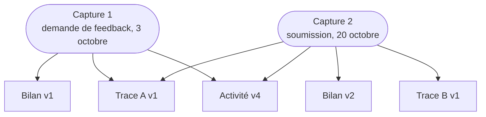

_La trace A et l'activité n'ont pas changé entre les deux captures : leurs versions sont partagées. Seuls le bilan modifié et la nouvelle trace B créent des versions._

Modèle logique (les membres et les gels sont stockés dans le document de la capture, voir [§3](#stockage)) :

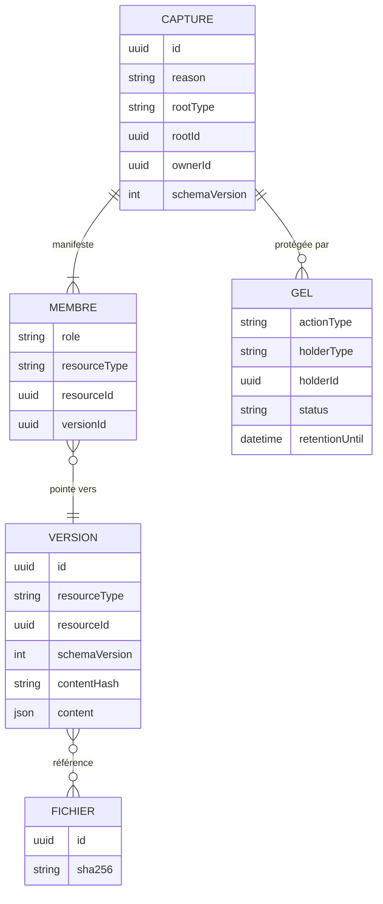

<details markdown="1" open>
<summary><strong>Exemple de manifeste</strong></summary>

```json
{
  "activity": {
    "resourceId": "7d1e...",
    "versionId": "0193a0..."
  },
  "realization": {
    "resourceId": "c42b...",
    "versionId": "0193f7...",
    "reflection": {
      "resourceId": "c42b...",
      "versionId": "0193f8..."
    },
    "associations": [
      {
        "resourceType": "TRACE",
        "resourceId": "5a1c...",
        "versionId": "0192e4..."
      },
      {
        "resourceType": "SKILL_PROGRESS",
        "resourceId": "91be...",
        "versionId": "0193f9..."
      },
      {
        "resourceType": "DECLARED_EXPERIENCE",
        "resourceId": "e03d...",
        "versionId": "0191c2..."
      }
    ],
    "children": []
  }
}
```

`children` accueillera les sous-réalisations ([#2815]), chacune avec ses propres `associations`.

</details>

> **Pourquoi pas une copie monolithique ?** Une copie monolithique de la réalisation à chaque action (la copie JSON actuelle des feedbacks, étendue) serait plus rapide à écrire. Mais chaque élément y serait enfoui dans la copie d'une réalisation : l'historique d'une trace ([#1320], phase 2) obligerait à fouiller toutes les copies où elle apparaît, et chaque type d'élément ne pourrait pas faire évoluer son format indépendamment. Avec des versions par élément, la même version sert à la capture (phase 1) et à l'historique de l'élément (phase 2).
> 
> **Pratique de référence : Git.** Un commit pointe vers une arborescence, qui pointe vers des objets identifiés par l'empreinte de leur contenu ; un fichier inchangé est partagé entre commits sans copie. Écart assumé : une version est identifiée par un UUID, pas par son empreinte. Une version porte aussi des métadonnées (propriétaire, auteur, date) et doit pouvoir être effacée avec les données de son propriétaire ; des objets partagés entre personnes compliqueraient cet effacement. La réutilisation se fait donc par élément (dernière version du même élément), pas entre utilisateurs.

### 2.4 Gels, détenteurs et politiques {#gels}

Chaque capture reçoit un gel au nom d'un **détenteur**, l'objet métier qui a besoin d'elle. Tant que le détenteur existe, la capture ne peut pas être purgée. Quand il disparaît, le gel reçoit une échéance (date de suppression plus délai de grâce), après laquelle la purge peut agir.

Un gel enregistre quoi, pourquoi, quand, par qui et selon quelle règle :

| Champ | Rôle |
| --- | --- |
| **`actionType`** | Action métier qui fige : `FEEDBACK_REQUEST`, `ASSESSMENT_SUBMISSION`, `COMPLETION` |
| **`actionId`** | Identifiant de l'opération : feedback, soumission ou capture de fin |
| **`holder`** | Détenteur : type et identifiant |
| **`actionAt`** | Date effective de l'action |
| **`actionBy`** | Auteur de l'action : type et identifiant |
| **`reasonCode`** | Motif codifié |
| **`policy`** | Politique appliquée : code et révision |
| **`status`** | `PENDING` (posé avant le commit PostgreSQL), `ACTIVE` (confirmé), `RELEASED` (libéré) |
| **`referenceEventAt`** | Date de l'événement de référence (suppression du détenteur) |
| **`retentionUntil`** | Échéance calculée de l'événement de référence |
| **`releasedAt`** | Date de libération |
| **`releaseReason`** | Libération : remplacé par un renvoi (`REPLACED`), transaction annulée (`ORPHAN`), effacement RGPD (`DELETED`) |

Catalogue de la phase 1 :

| Action | Détenteur | Politique | Événement de référence | Délai de grâce par défaut |
| --- | --- | --- | --- | --- |
| **`FEEDBACK_REQUEST`** | Feedback | `FEEDBACK_REQUEST`, révision 1 | Suppression du feedback | 0 jour |
| **`ASSESSMENT_SUBMISSION`** | Soumission ([§2.7](#soumission)) | `ASSESSMENT_SUBMISSION`, révision 1 | Suppression de la soumission (aujourd'hui, de la réalisation) | 0 jour |
| **`COMPLETION`** | Réalisation | `COMPLETION`, révision 1 | Suppression de la réalisation | 0 jour |

Les trois politiques ont la même forme (échéance comptée à partir d'un événement, ici la suppression du détenteur) ; leurs codes distincts permettent d'en faire évoluer une sans toucher aux autres.

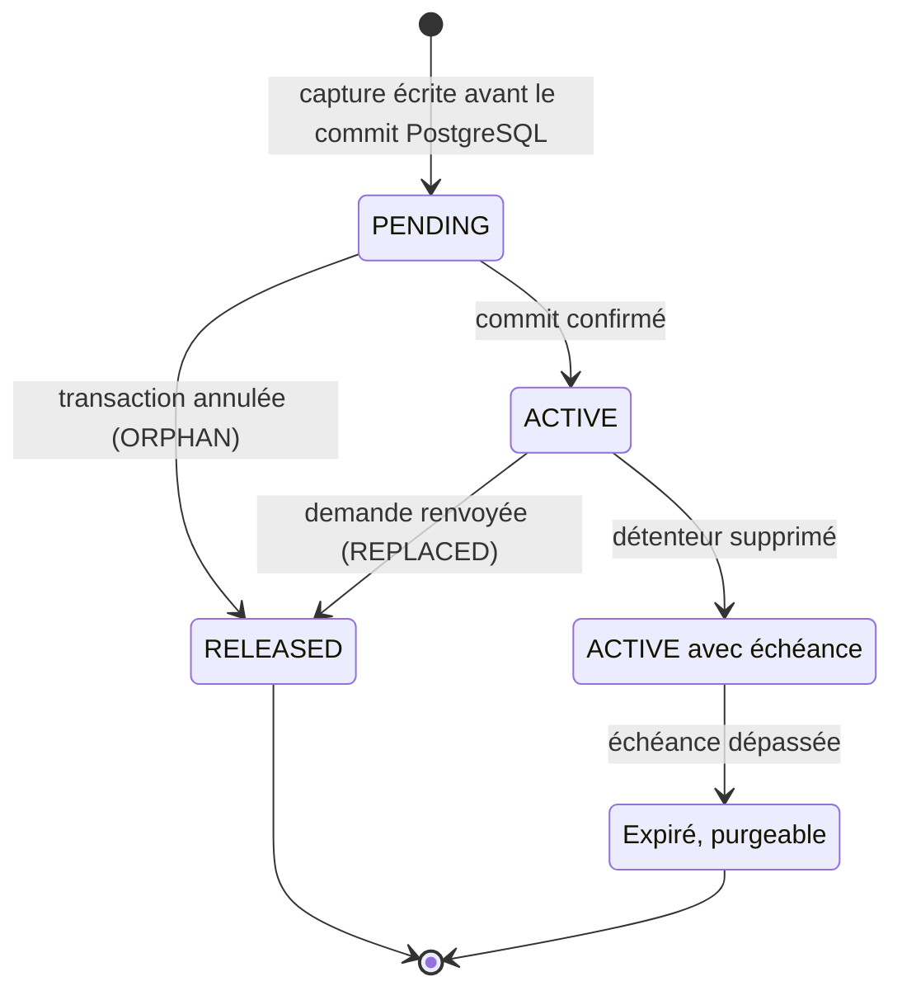

Une version est **figée** si un gel `PENDING`, ou `ACTIVE` dont l'échéance n'est pas dépassée, la protège, directement ou via une capture qui la contient. Ce statut se calcule ; il n'est jamais stocké.

> **Pourquoi un gel lié au détenteur plutôt qu'une durée fixe ?** Une durée comptée depuis l'action (par exemple "2 ans après la transmission") purgerait une capture alors que le feedback ou l'évaluation qui la référence existe encore, et l'enregistrement pointerait vers un contenu disparu. Lier le gel au détenteur évite ce cas : la capture suit la durée de vie des données de l'apprenant.
> 
> **Pourquoi plusieurs gels, et des politiques versionnées ?** Plusieurs gels permettent d'ajouter plus tard une protection sur une capture existante, par exemple une conservation exceptionnelle en cas de contentieux, sans la copier. Une politique identifiée par un code et une révision, jamais modifiée manuellement, permet d'expliquer une purge passée avec la règle en vigueur à l'époque, et de changer une règle sans réinterpréter en silence les gels existants.
> 
> **À challenger.** Une conservation liée au détenteur ne doit pas devenir une conservation illimitée par défaut (RGPD, article 5, limitation de la conservation). Ici, la durée est bornée par celle des données de l'apprenant, qui reste à fixer. Si une durée maximale est imposée, on ajoute un plafond (par exemple N ans après la fin de la réalisation) par une nouvelle révision de politique, sans changer de structure ; le détenteur doit alors être purgé ou anonymisé à la même date.
> 
> **Pratique de référence.** Les outils de gestion documentaire distinguent la rétention déclenchée par un événement (Microsoft Purview : la durée de conservation part d'un événement, comme la fin d'un contrat) et les *holds*, qui suspendent toute suppression tant qu'ils sont posés. Le gel combine les deux : il suspend la purge tant que le détenteur existe, puis fait partir l'échéance de sa suppression. Le *legal hold* de S3 Object Lock, un simple statut actif ou inactif par version, ne permet pas plusieurs protections indépendantes ([§4.4](#versioning-s3)).

### 2.5 Quand capture-t-on ? {#declencheurs}

| Événement métier | Capture | Gel | Remarque |
| --- | --- | --- | --- |
| **Demande de feedback** | oui | `FEEDBACK_REQUEST`, détenteur : le feedback | Remplace la copie JSON actuelle |
| **Renvoi de la demande tant qu'elle est** `NEW` | oui, nouvelle capture | le nouveau gel est confirmé, l'ancien libéré (`REPLACED`) | Même feedback, même itération |
| **Ouverture par le STAFF** (`NEW` -> `IN_PROCESS`) | non | - | La demande est déjà figée par sa capture ; le renvoi devient impossible |
| **Réponse du STAFF à la demande** | non | - | Contenu du STAFF, modifiable jusqu'à sa consultation par l'apprenant (`SEEN`) ; aucune US n'en demande l'historique |
| **Soumission pour évaluation** ([#2531]) | oui | `ASSESSMENT_SUBMISSION`, détenteur : la soumission | Critère 1 de [#988] |
| **Envoi de l'évaluation** ([#2776]) | non | - | Le contenu évalué est celui de la capture de soumission ; l'envoi termine la réalisation |
| **Modification de l'évaluation** ([#1311]) | non | - | Sans nouvelle version ni historique, comme le demande [#1311] |
| **Fin d'une réalisation sans évaluation** ("Terminer") | oui | `COMPLETION`, détenteur : la réalisation | Tient la promesse du front pour les activités terminées ; utile aussi en cas de réouverture ([#3046]) |
| **Réouverture** ([#3046], à venir) | non | - | Les captures précédentes restent liées à leurs soumissions |
| **Nouvelle soumission après réouverture** (à venir) | oui | `ASSESSMENT_SUBMISSION`, nouvelle soumission | "Chaque nouvelle soumission doit pouvoir être distinguée des soumissions précédentes" ([#3046]) |

> **Ce que contient une demande de feedback.** La proposition garde le comportement actuel du code, conforme à [#2641] ("au moment de l'envoi de la demande") : la demande contient l'état de la réalisation **au dernier envoi**. Tant que le STAFF ne l'a pas ouverte, l'apprenant peut la modifier en la renvoyant ; dès que le STAFF l'ouvre, elle est figée.
> 
> **Variante, à trancher par le PO :** reprendre automatiquement les modifications faites sans renvoi, jusqu'à l'ouverture par le STAFF. Techniquement, il suffirait de déplacer la capture de l'envoi vers l'ouverture. Mais l'apprenant ne saurait pas toujours ce qu'il a transmis, la règle de [#2641] serait à modifier, et [#988] demande de ne pas changer le parcours fonctionnel.

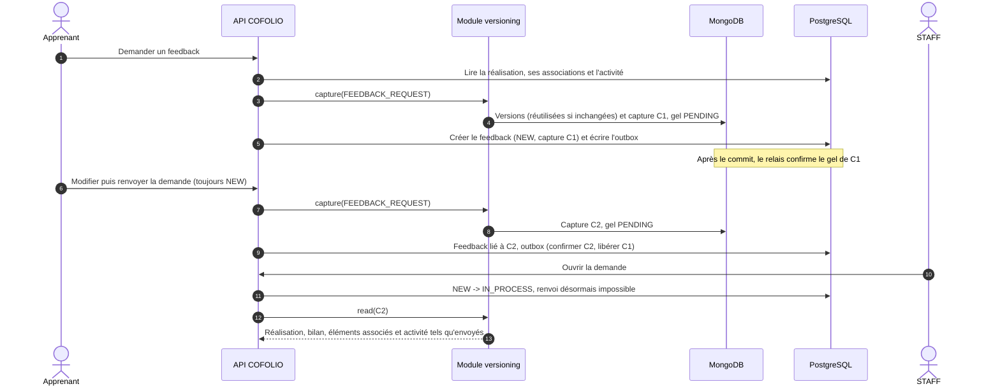

### 2.6 Lecture d'une capture {#lecture}

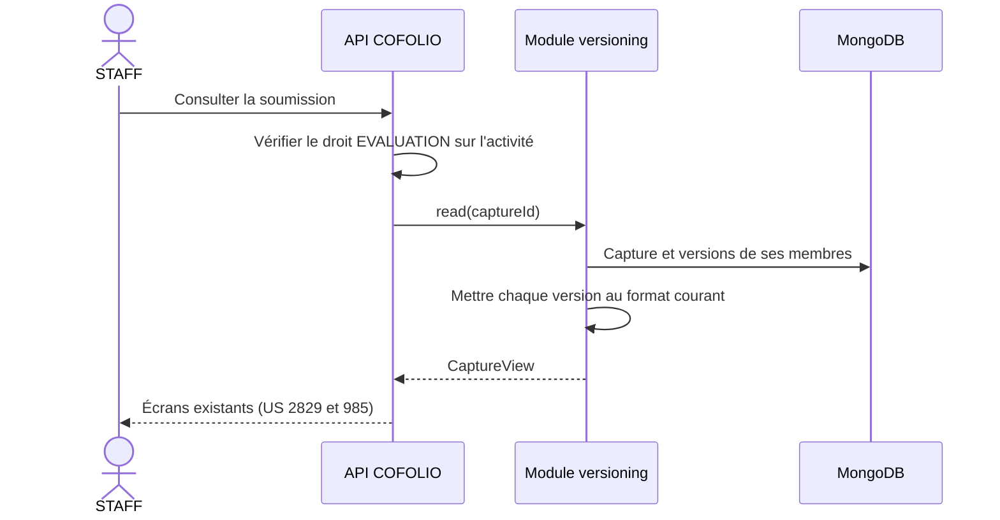

- **Les droits ne changent pas** : le STAFF doit avoir le droit `FEEDBACK`/`EVALUATION` sur l'activité ; l'apprenant doit être le propriétaire de la réalisation.
- **La lecture ne dépend plus de l'état courant** : une trace supprimée ou modifiée depuis reste visible telle qu'elle a été transmise, comme le front l'annonce déjà (C2).
- **Le module de versioning renvoie des objets du domaine** : les DTO existants ([#2829], [#985], [#1656]) sont réutilisés.
- **Côté apprenant** : si le PO le confirme, les écrans d'une réalisation soumise ou terminée lisent sa dernière capture, ce qui tient la promesse des modales de modification et de suppression des traces. Techniquement, c'est le même appel.

### 2.7 Soumission et rattachement de l'évaluation {#soumission}

[#988] demande de rattacher l'évaluation à la version soumise. [#3046] demandera ensuite plusieurs soumissions par réalisation, et [#3044] plusieurs contributions à l'évaluation : chaque soumission aura ses contributions et son évaluation finale.

**Phase 1 ([#988]).** Pas encore de table des soumissions. À la soumission, l'API génère un identifiant de soumission (UUID) et le stocke dans l'évaluation, avec l'identifiant de la capture :

| Colonne ajoutée (embeddable `assessment`) | Rôle |
| --- | --- |
| **`assessment_submission_id`** | Identifiant de la soumission, détenteur du gel |
| **`assessment_capture_id`** | Capture soumise ; l'évaluation envoyée ([#2776]) s'y rattache |

**Cible ([#3044], [#3046]).** Une table `submission` dont la clé est cet identifiant. La migration crée une ligne par évaluation existante en reprenant les mêmes identifiants ; rien ne change côté MongoDB, puisque les gels pointent déjà vers eux.

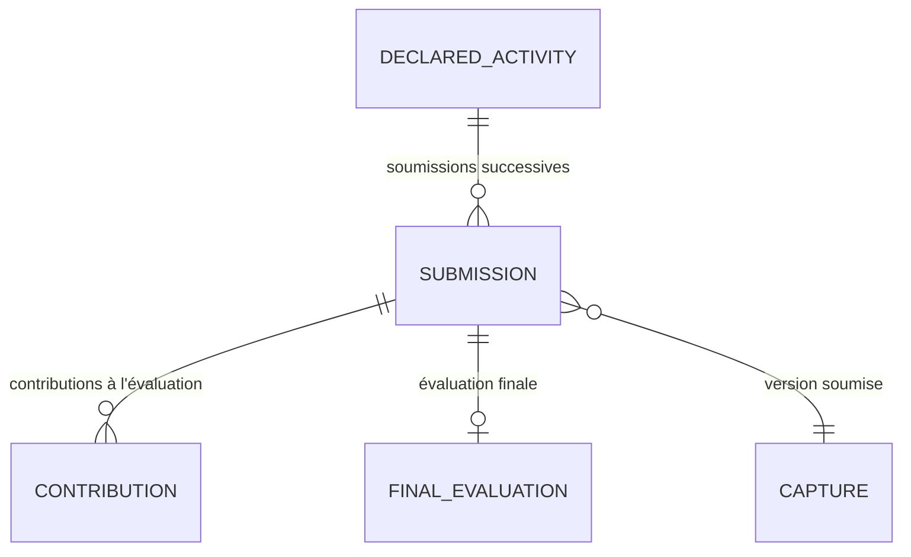

> **Pourquoi ne pas créer la table dès maintenant ?** [#988] exclut les soumissions successives ; créer la table avant d'en connaître les règles (contributions, droits, consultation) risquerait une seconde migration ; et l'identifiant généré dès aujourd'hui rend la transition naturelle.
> 
> **Et l'enregistrement automatique des contributions ([#3044]) ?** C'est un brouillon : la saisie en cours est retrouvée au retour de son auteur, sans être montrée à l'apprenant. Il n'appelle ni version ni entrée de journal (HF7).

### 2.8 Cohérence entre PostgreSQL et MongoDB {#coherence}

L'action métier (créer un feedback, soumettre) est écrite dans PostgreSQL et la capture dans MongoDB : aucune transaction ne couvre les deux bases. Le protocole repose sur une règle simple : **écrire d'abord le contenu immuable, ensuite la référence**, comme Git écrit ses objets avant de déplacer une branche.

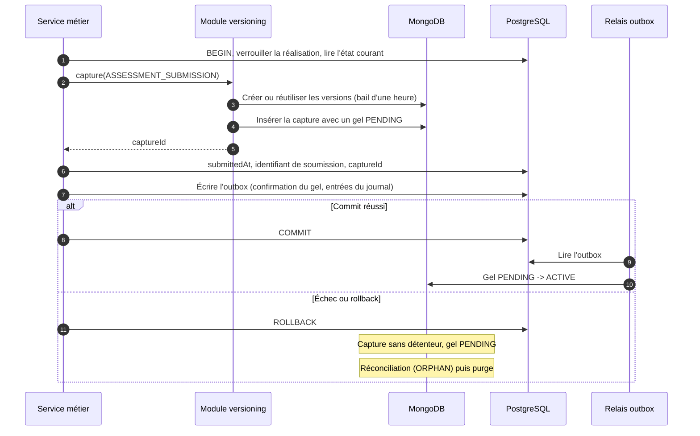

| Situation | Effet | Rattrapage |
| --- | --- | --- |
| MongoDB indisponible | L'action métier échoue ; l'utilisateur peut réessayer | Aucun : rien n'a été écrit dans PostgreSQL |
| Échec après l'écriture dans MongoDB | Capture sans détenteur, gel `PENDING` | La réconciliation la libère (`ORPHAN`) après le délai d'attente, puis la purge la supprime |
| Relais outbox arrêté | Le gel reste `PENDING`, ce qui protège déjà la capture | Confirmé au redémarrage du relais ou par la réconciliation |
| Double clic, soumissions concurrentes | Le verrou PostgreSQL sur la réalisation les traite l'une après l'autre : la seconde trouve la réalisation déjà soumise et est refusée avant toute capture | - |
| Purge pendant qu'une capture réutilise une version | La version porte un bail d'une heure, que la purge respecte | - |
| Sauvegardes PostgreSQL et MongoDB restaurées à des instants différents | Références vers des captures absentes, ou captures sans détenteur | La réconciliation signale les premières et libère les secondes |

Compléments :
- **Pas de transaction MongoDB multi-documents.** Chaque écriture est idempotente (identifiant de capture généré par l'API, réutilisation par empreinte) et s'appuie sur l'atomicité d'un document, les gels étant stockés dans la capture. _MongoDB est malgré tout déployé en replica set, pour la haute disponibilité et pour disposer des transactions si on en a besoin un jour._
- **Saisie en cours** (C7). Le front force l'enregistrement du bilan avant "Demander un feedback", "Soumettre" et "Terminer". Risque résiduel en phase 1 : une modification enregistrée depuis un autre onglet juste avant l'action peut être figée sans avoir été vue. En phase 2, l'action transmettra la révision attendue (`If-Match`) et sera refusée si le bilan a changé entre-temps ([§8.4](#concurrence)).
- **Durée de la transaction.** La transaction PostgreSQL reste ouverte pendant les écritures dans MongoDB, ce qui est acceptable parce qu'elles sont courtes (quelques documents). Un délai maximal est imposé au client MongoDB pour ne jamais retenir le verrou longtemps.
- **Lecture cohérente.** La capture est construite à partir de l'état lu dans la transaction métier, après verrouillage de la réalisation.

> **Pourquoi pas plus simple ?** Une transaction distribuée (validation en deux phases) n'est pas disponible : MongoDB ne participe pas aux transactions. Valider une base puis l'autre en espérant que tout se passe bien laisse un état incohérent si la seconde échoue : c'est précisément le cas que le protocole traite explicitement. Écrire d'abord dans PostgreSQL serait pire : un feedback pourrait référencer une capture qui n'existe pas.
> 
> **Pratique de référence.** Le gel `PENDING` puis `ACTIVE` applique le patron *Try-Confirm-Cancel* : on réserve, on confirme après le commit, et la réconciliation annule ce qui n'a jamais été confirmé. Le bail est un *lease* : une réservation limitée dans le temps, qui expire d'elle-même si son détenteur disparaît.

### 2.9 Évolution du format des versions {#format}

Le format d'une version évolue avec le modèle : un champ est ajouté, renommé ou supprimé. Deux façons de gérer les versions déjà stockées :

| | Mise à niveau à la lecture | Migration en masse |
| --- | --- | --- |
| **Principe** | Chaque version garde son format d'origine (`schemaVersion`) ; à la lecture, une chaîne de convertisseurs l'amène au format courant | Un traitement réécrit toutes les versions au nouveau format |
| **Versions figées** | Jamais modifiées : leur empreinte permet de vérifier qu'elles n'ont pas changé | Réécrites : l'empreinte change, et l'on ne peut plus vérifier le contenu d'origine |
| **Coût** | Un convertisseur par changement de format, à garder tant que des versions de ce format existent | Un traitement sur tout le volume à chaque changement, avec un risque d'erreur en masse |
| **Pratique établie** | Patron *Schema Versioning* de MongoDB, *upcasting* des systèmes à base d'événements | Migrations de schéma relationnel |

**Décision proposée :** mise à niveau à la lecture par défaut. La migration en masse reste exceptionnelle (pour retirer un très vieux convertisseur, par exemple) : elle passe par un traitement explicite et journalisé, qui conserve le format et l'empreinte d'origine dans un champ `migratedFrom`.

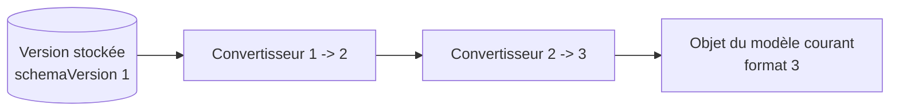

Règles :
- Chaque type d'élément a un **codec** : format courant, sérialisation canonique pour l'empreinte (JSON canonique selon la RFC 8785 ; pour le texte riche, le HTML tel qu'enregistré) et chaîne de convertisseurs `n -> n+1`.
- L'empreinte sert à reconnaître un contenu identique, pas à juger d'une équivalence fonctionnelle : deux contenus équivalents mais écrits différemment donnent deux versions, ce qui est sans risque.
- Chaque convertisseur est une fonction pure, testée sur un exemple réel de chaque format historique.
- Le manifeste des captures a aussi son `schemaVersion`.
- Les versions temporaires de la phase 2 disparaissent au plus tard après 90 jours ; seules les versions figées obligent à garder un convertisseur longtemps.

> **Pourquoi pas plus simple ?** Une lecture tolérante (ignorer les champs inconnus, valeurs par défaut pour les champs absents) suffit pour un ajout de champ ; c'est d'ailleurs ce que fera le premier convertisseur. Mais un renommage ou un changement de type exige une conversion, et une lecture tolérante masque les erreurs au lieu de les signaler. La chaîne de convertisseurs rend chaque changement explicite et testé.
> 
> **Pratique de référence.** MongoDB documente le patron *Schema Versioning* : chaque document porte la version de son schéma et l'application sait lire toutes les versions en circulation. Les systèmes à base d'événements appellent *upcasting* la conversion des anciens événements au moment de les lire, parce qu'un événement stocké ne doit pas être réécrit. Une version figée est dans la même situation. Pour l'empreinte, le JSON canonique (RFC 8785) garantit qu'un même contenu donne toujours la même suite d'octets, quel que soit l'ordre des champs.

### 2.10 Couverture de #988 {#couverture-988}

| Critère | Exigence de [#988] | Réponse |
| --- | --- | --- |
| 1 | La version est créée lors de la soumission ([#2531]) | Capture dans le traitement de la soumission ([§2.5](#declencheurs)) |
| 1 | Elle est rattachée à la réalisation de l'apprenant | La racine de la capture est la réalisation |
| 1 | La date de soumission est conservée | `submittedAt` dans PostgreSQL ; date de la capture et du gel dans MongoDB |
| 1 | Elle est conservée indépendamment des modifications ultérieures | Versions immuables, gel tant que la soumission existe |
| 2 | Le STAFF évalue le contenu tel qu'il a été soumis | `VersioningService.read` ([§2.6](#lecture)) |
| 2 | La consultation reste définie par [#2829] | Écrans inchangés, seule la source des données change |
| 2 | Pas de modification rétroactive | Immuabilité et lecture depuis la capture |
| 2 | Périmètre des données à figer, à définir en affinage | [§2.2](#perimetre) |
| 3 | L'évaluation est rattachée à la version concernée | `assessment_capture_id` ([§2.7](#soumission)) |
| 3 | Envoi défini par [#2776] ; résultat et statut inchangés | Pas de capture à l'envoi ; la capture est une donnée annexe |
| Notes | Plusieurs versions plus tard, sans refonte importante | N captures par réalisation dès la phase 1 ; identifiant de soumission prêt pour [#3046] |
| Notes | Réutilisation de mécanismes existants, comme [#1191] | [#1191] journalise, il ne versionne pas : il réutilisera le journal d'actions ([§5](#journal)), pas les captures |
| Hors périmètre | Distinction avec [#3018] | Captures et journal sont deux mécanismes distincts |

## 3. Phase 1 : stockage dans MongoDB {#stockage}

### 3.1 Collections {#collections}

| Collection | Contenu | Écrite par | Lue par |
| --- | --- | --- | --- |
| **`versions`** | Une version d'un élément : contenu complet, empreinte, format, fichiers référencés, bail | capture (et enregistrements en phase 2) | lecture des captures, purge |
| **`captures`** | Manifeste, liste à plat des membres, gels | capture, relais outbox, réconciliation | lecture par l'utilisateur (STAFF dans le cas de l'US [#988]), purge |
| **`retention_policies`** | Politiques de conservation (code et révision) | migrations | capture, relais |
| **`action_log`** | Journal d'actions ([§5](#journal)) | relais outbox | SUPER ADMIN, développeurs autorisés, etc. |

### 3.2 Exemples de documents {#exemples}

<details markdown="1" open>
<summary><strong>Document de la collection <code>versions</code></strong></summary>

```json
{
  "_id": "0193f7a2-5c1e-7b3a-9d0f-3c2e1a4b5c6d",
  "resourceType": "TRACE",
  "resourceId": "5a1c2d3e-...",
  "ownerId": "8f00a1b2-...",
  "schemaVersion": 1,
  "contentHash": "sha256:9c1185a5c5e9fc54612808977ee8f548b2258d31...",
  "content": {
    "title": "Compte rendu de stage",
    "language": "FRENCH",
    "authorType": "PERSONAL",
    "aiUseJustification": null,
    "personalNote": "À compléter avec le bilan du tuteur",
    "link": null,
    "attachment": {
      "fileId": "f3e1...",
      "name": "rapport.pdf",
      "mimeType": "application/pdf",
      "size": 482113,
      "sha256": "4b2a..."
    },
    "createdAt": "2026-10-02T08:14:03Z",
    "updatedAt": "2026-10-20T16:41:55Z"
  },
  "fileIds": ["f3e1..."],
  "origin": "BUSINESS_ACTION",
  "createdAt": "2026-10-20T17:02:11Z",
  "createdBy": {
    "type": "USER",
    "id": "8f00a1b2-..."
  },
  "leaseUntil": "2026-10-20T18:02:11Z"
}
```

</details>

<details markdown="1" open>
<summary><strong>Document de la collection <code>captures</code></strong></summary>

```json
{
  "_id": "0193f7a2-61aa-7c00-8e21-9b0c7d6e5f40",
  "reason": "ASSESSMENT_SUBMISSION",
  "root": {
    "type": "DECLARED_ACTIVITY",
    "id": "c42b..."
  },
  "ownerId": "8f00a1b2-...",
  "schemaVersion": 1,
  "manifest": {
    "activity": {
      "resourceId": "7d1e...",
      "versionId": "0193a0..."
    },
    "realization": {
      "...": "voir l'exemple de manifeste du §2.3"
    }
  },
  "memberVersionIds": [
    "0193a0...",
    "0193f7...",
    "0193f8...",
    "0192e4..."
  ],
  "createdAt": "2026-10-20T17:02:11Z",
  "createdBy": {
    "type": "USER",
    "id": "8f00a1b2-..."
  },
  "freezes": [
    {
      "id": "0193f7a2-61ab-...",
      "actionType": "ASSESSMENT_SUBMISSION",
      "actionId": "4d2e...",
      "holder": {
        "type": "SUBMISSION",
        "id": "4d2e..."
      },
      "actionAt": "2026-10-20T17:02:11Z",
      "actionBy": {
        "type": "USER",
        "id": "8f00a1b2-..."
      },
      "reasonCode": "SUBMITTED_FOR_ASSESSMENT",
      "policy": {
        "code": "ASSESSMENT_SUBMISSION",
        "revision": 1
      },
      "status": "ACTIVE",
      "referenceEventAt": null,
      "retentionUntil": null,
      "releasedAt": null,
      "releaseReason": null
    }
  ]
}
```

</details>

### 3.3 Index {#index-mongodb}

| Collection | Index | Usage |
| --- | --- | --- |
| `versions` | `{ resourceType: 1, resourceId: 1, createdAt: -1 }` | Dernière version d'un élément (réutilisation), historique |
| `versions` | `{ ownerId: 1 }` | Effacement par personne |
| `versions` | `{ fileIds: 1 }` | Le nettoyage vérifie qu'aucune version ne référence un fichier |
| `captures` | `{ "freezes.holder.type": 1, "freezes.holder.id": 1 }` | Gels d'un détenteur (confirmation, suppression) |
| `captures` | `{ memberVersionIds: 1 }` | La purge vérifie qu'aucune capture ne référence une version |
| `captures` | `{ "freezes.status": 1, "freezes.actionAt": 1 }` | Réconciliation des gels `PENDING` |
| `captures` | `{ ownerId: 1 }` et `{ "root.type": 1, "root.id": 1, createdAt: -1 }` | Effacement par personne ; captures d'une réalisation |
| `retention_policies` | `{ code: 1, revision: 1 }`, unique | Résolution d'une politique |

### 3.4 Volumétrie {#volumetrie}

Faute de chiffres réels, voici un ordre de grandeur par capture, à remplacer par des mesures :

| Élément | Taille indicative | Nouvelle version à chaque capture ? |
| --- | --- | --- |
| Manifeste | 1 à 2 Ko | oui |
| Bilan (texte riche, 4 000 caractères au plus) | 2 à 8 Ko | souvent |
| Trace, compétence, expérience, formation | 0,5 à 2 Ko chacune | seulement si l'élément a changé |
| Activité (consignes en texte riche) | 5 à 20 Ko | rarement : une même version sert à tous les inscrits |

Cela représente environ 5 à 15 Ko de données nouvelles par capture. Avec l'hypothèse de 100 000 apprenants actifs, 10 réalisations par an et 2 captures par réalisation, on obtient 2 millions de captures et 10 à 30 Go par an avant compression, que MongoDB active par défaut. Les fichiers ne sont pas dupliqués ([§4](#fichiers)).

### 3.5 ADR : MongoDB dès la phase 1 {#adr-mongodb}

**Statut :** proposé.

**Contexte.** Le [module Stockage](../arch-soft-specif-storage) du dossier d'architecture (de 2024) prévoyait S3 pour la gestion des versions ; MongoDB a ensuite été proposé, en amont de cette RFC, pour l'historisation et les logs. S3 reste le stockage des fichiers ([§4](#fichiers)). Les versions sont des documents immuables, au format évolutif, sans jointure, lus par identifiant ; le journal est un flux en ajout seul, interrogé par période, par acteur ou par objet. Commencer dans PostgreSQL imposerait plus tard une migration de données.

**Décision.** Versions, captures, gels, politiques et journal sont stockés dans MongoDB dès la phase 1. PostgreSQL garde l'état courant, les références aux captures, l'outbox et le registre d'usages des fichiers.

**Conséquences.**
- (+) Pas de migration de stockage le jour où l'historique de travail fera croître les volumes.
- (+) Format souple, adapté à la mise à niveau à la lecture.
- (-) Une base de plus à exploiter : replica set, sauvegardes, supervision, etc.
- (-) Pas de transaction commune avec PostgreSQL : protocole de cohérence, réconciliation et purge à écrire et à tester ([§2.8](#coherence)).
- (-) Consulter une capture dépend de la disponibilité de MongoDB.

**Alternatives écartées.**
- Tout dans PostgreSQL : plus simple et transactionnel, mais une migration serait à prévoir ([§3.7](#variante-postgresql)).
- Gels dans PostgreSQL, contenus dans MongoDB : la cohérence entre les deux bases reste nécessaire, et le module de versionnement serait coupé en deux.

### 3.6 Variante tout PostgreSQL {#variante-postgresql}

La [synthèse](../rfc-versionnement-historisation#alternatives) chiffre ce que coûte la séparation en deux bases. Si D1 est abandonnée, le modèle se transpose sans changer de concepts :

| Proposé (MongoDB) | Variante (PostgreSQL) |
| --- | --- |
| Collection `versions` | Table `resource_version` : contenu en JSONB, empreinte, format |
| Collection `captures` (manifeste, membres, gels) | Tables `capture` (manifeste en JSONB), `capture_member` et `freeze`, avec clés étrangères |
| Collection `retention_policies` | Table `retention_policy` |
| Collection `action_log` | Table `action_log` partitionnée par mois : purger revient à supprimer une partition |
| Gel `PENDING`, réconciliation, bail | Inutiles : action métier, capture et gel dans la même transaction |
| Outbox | Réduite aux suppressions d'objets S3 |

Ce qui ne change pas : les ports, les codecs, la mise à niveau à la lecture, le registre d'usages et le format du journal. Passer de l'une à l'autre plus tard resterait une migration de données : c'est elle que D1 veut éviter.

## 4. Phase 1 : fichiers {#fichiers}

### 4.1 Rappel et principe {#fichiers-principe}

- **Besoin :** garder la pièce jointe telle qu'elle a été transmise ou évaluée et ne plus laisser de fichiers orphelins.
- **Hypothèse :** HT5.
- **Constats :** C5, C6, C10.

Les fichiers sont déjà **immuables** : un dépôt crée un nouvel objet S3, avec une nouvelle clé, jamais réécrite (C5). Il suffit donc :
- De **référencer** le fichier exact depuis les versions qui l'utilisent, sans copie lors d'un gel.
- De **ne le supprimer que lorsque plus rien ne l'utilise**, ni l'état courant ni une version.

L'historique d'une pièce jointe se lit dans celui de son propriétaire : chaque version d'une trace indique quel fichier y était attaché.

### 4.2 Registre d'usages et empreinte {#registre}

PostgreSQL tient un registre des usages courants :

```sql
-- Usages courants d'un fichier : une ligne par propriétaire
create table file_usage (
    file_id    uuid        not null references file (id),
    owner_type varchar(50) not null, -- TRACE_ATTACHMENT, ACTIVITY_DOCUMENT, FEEDBACK_ATTACHMENT, PROFILE_PICTURE, etc.
    owner_id   uuid        not null,
    created_at timestamptz not null default now(),
    primary key (file_id, owner_type, owner_id)
);

alter table file add column sha256 char(64);          -- empreinte du contenu
alter table file add column unused_since timestamptz; -- date du retrait du dernier usage
```

- Le service de fichiers met à jour le registre à chaque rattachement ou détachement ; c'est le seul point d'entrée.
- L'empreinte SHA-256 permet d'ignorer un redépôt strictement identique. Elle rendrait aussi possible une déduplication, qui n'est pas prévue entre utilisateurs, pour garder l'effacement par personne simple.
- Les usages historiques sont dans MongoDB (`versions.fileIds`).

> **Pourquoi pas plus simple ?** Sans registre, chaque module exposerait une requête "parmi ces fichiers, lesquels utilisez-vous ?", comme le fait aujourd'hui `findAttachmentIdsUsedByTraceSnapshots`. C'est plus léger à mettre en place, mais il faut y penser pour chaque nouveau module, et un oubli supprime des fichiers encore utilisés. Le registre est explicite et centralisé.
> 
> **Pratique de référence.** La *File API* de Moodle stocke chaque contenu une seule fois, identifié par son empreinte, et enregistre une ligne par usage (composant, zone, élément). Le registre reprend l'idée d'une ligne par usage ; il ne partage pas les contenus entre utilisateurs.

### 4.3 Nettoyage {#nettoyage}

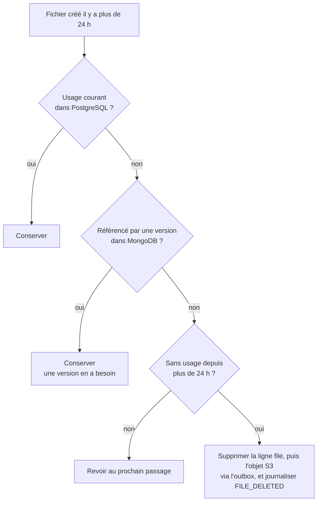

- Le nettoyage devient le seul endroit qui supprime un fichier : les appels directs actuels deviennent des retraits d'usage (C10).
- Il remplace la requête `findAttachmentIdsUsedByTraceSnapshots` et supprime les fichiers orphelins (C5) comme les dépôts jamais rattachés.
- Le délai de 24 heures couvre une capture en cours d'écriture et un dépôt pas encore rattaché.
- **La référence d'abord, l'objet ensuite.** La ligne `file` est supprimée en premier, seulement si aucun usage n'existe (la clé étrangère du registre l'empêche de toute façon), dans une transaction qui inscrit dans l'outbox la suppression de l'objet S3 ; le relais supprime ensuite l'objet. C'est l'ordre inverse de la création : un échec laisse au pire un objet en attente de suppression, jamais une référence vers un objet absent.
- Chaque suppression produit une entrée `FILE_DELETED` dans le journal, avec l'identifiant et l'empreinte du fichier, mais pas son nom.

> **Pratique de référence.** `git gc` ne supprime un objet devenu inaccessible qu'après un délai (deux semaines par défaut), parce qu'un autre processus peut l'avoir écrit sans l'avoir encore référencé. Le délai de 24 heures joue le même rôle, plus court parce que nos écritures durent quelques secondes.

### 4.4 Et le versioning natif de S3 ? {#versioning-s3}

| Critère | Versioning S3 | Objets immuables et registre |
| --- | --- | --- |
| Protéger une version précise | *Legal hold* : un statut actif ou inactif par version | Gels avec détenteurs, cumulables ([§2.4](#gels)) |
| Plusieurs raisons de conserver | Impossible : un seul statut par version, alors qu'une capture peut avoir plusieurs gels indépendants | Prévu par le modèle |
| Rétention | Règles de cycle de vie par âge ou par nombre (100 versions non courantes au plus), aveugles aux gels métier | Purge qui revérifie les gels |
| Suppression RGPD | Un `DELETE` sans identifiant de version ne fait que poser un marqueur ; il faut supprimer chaque version | Suppression directe de l'objet |
| Dépendance | Fonctionnalités à vérifier chez l'hébergeur (versioning, Object Lock) | S3 de base |

**Décision proposée :** les versions métier reposent sur les objets immuables et le registre. Le versioning S3 peut être activé en plus, comme **filet de sécurité d'infrastructure** contre une suppression accidentelle (par exemple, versions non courantes conservées 7 jours).

## 5. Phase 1 : journal d'actions {#journal}

### 5.1 Rappel {#journal-besoin}

- **Besoins :** [#3018] (format commun ; un log seulement quand l'action "a effectivement été réalisée et enregistrée" ; des logs distincts pour des événements distincts ; date et heure à la seconde ; auteur et, s'il diffère, utilisateur concerné ; nature de l'action ; objet et contexte métier) ; [#1191] (actions sur les traces, lecture réservée au SUPER ADMIN et à des développeurs autorisés) ; [#3023] (droits sur une activité) ; [#2791] (suppression définitive d'une activité, [#1189]).
- **Hypothèses :** HF6, HF7, HF8, HT4, HT6.
- **Constats :** C8, C9, C12, C13, C14.

Le journal répond à [#3018] : garder une trace des actions effectivement réalisées, pour l'administration technique et le diagnostic ([#1191]) et pour la traçabilité demandée par les US ([#3023], [#2791]).
- Il **ne versionne rien** : il décrit une action, il ne conserve pas le contenu. Pour le contenu, ce sont les captures.
- Il est **en ajout seul** : une entrée est écrite une fois, jamais modifiée, puis purgée à son échéance.
- Il est **distinct des logs techniques** (Logback) et ne sert pas au reporting.

### 5.2 Format commun {#format-journal}

| Exigence de [#3018] | Champ | Contenu |
| --- | --- | --- |
| **Date et heure à la seconde** | `occurredAt` | Date effective de l'action, au format ISO 8601 en UTC, à la milliseconde |
| **Auteur de l'action** | `actor` | `type` (`USER` ou `SYSTEM`), `id` de l'utilisateur et, pour une action d'administration, le droit exercé (`authority`, par exemple `activity:admin:management` pour une suppression définitive) |
| **Utilisateur concerné**, s'il diffère de l'auteur | `relatedUserId` | Par exemple, le membre du STAFF dont les droits changent ([#3023]) |
| **Nature de l'action** : ajout, modification ou suppression | `operation` | `ADD`, `UPDATE` ou `DELETE` |
| **Type d'objet et objet concernés** | `target` | `type` et `id` |
| **Contexte métier** | `context` | `institutionIds` au moment de l'action, `national`, `activityId`, `declaredActivityId`, etc. |
| **Données propres à la fonctionnalité** | `type` et `details` | Événement précis (`TRACE_ASSOCIATED`, `ACTIVITY_RIGHT_GRANTED`, etc.) et quelques données utiles, jamais de contenu |
| **Ajouts de la RFC** | `versionRef`, `origin`, `correlationId`, `schemaVersion`, `expiresAt` | Capture liée, provenance (front apprenant, front STAFF, back-office, traitement), identifiant de requête ([§5.9](#services)), format de l'entrée, date d'expiration |

Règles :
- **Institutions.** Pour un objet de l'utilisateur (trace, réalisation, etc.), ce sont ses institutions au moment de l'action, fournies par le back-office (`/access`) ; pour une activité, ses institutions cibles ou `national`. Elles sont stockées telles quelles, parce que les rattachements changent avec le temps.
- **Droit exercé.** L'autorisation repose sur des droits (`@PreAuthorize("hasAuthority(...)")`) plus que sur des rôles : pour une action d'administration, l'entrée enregistre le droit qui l'a permise, ce qui dit pourquoi l'action était autorisée.
- **Construction synchrone.** L'entrée (acteur, contexte, horodatage) est construite dans la transaction métier, car le contexte de requête ne survit pas au passage en asynchrone (C8). Seul l'envoi est asynchrone.
- **Vocabulaire stable.** Les événements sont nommés `OBJET_VERBE`, comme chez Moodle et dans le vocabulaire de journalisation de l'OWASP. Un changement de droits enregistre l'avant et l'après (`from`, `to`), comme l'événement `authz_change` de l'OWASP.
- **Pas de contenu.** On enregistre l'action et l'identifiant de l'objet, pas son contenu : ni texte, ni nom de fichier. Seule exception : le libellé nécessaire pour reconnaître un objet supprimé définitivement, comme le titre d'une activité ([#2791]), qui n'est pas une donnée personnelle.

> **Pratique de référence.** L'OWASP (*Logging Vocabulary Cheat Sheet*) propose des noms d'événements stables, une date ISO 8601 avec son décalage UTC, et l'absence de données sensibles dans les journaux. Le format reprend ces trois points et les complète par les exigences de [#3018].

### 5.3 Exemple {#exemple-journal}

<details markdown="1" open>
<summary><strong>Entrée produite par un changement de droits sur une activité (<a href="https://github.com/avenirs-esr/AVENIRS-Project/issues/3023">#3023</a>)</strong></summary>

```json
{
  "_id": "0193f8b1-2c4d-7e5f-8a9b-0c1d2e3f4a5b",
  "schemaVersion": 1,
  "occurredAt": "2026-11-09T14:02:11.482Z",
  "type": "ACTIVITY_RIGHT_UPDATED",
  "operation": "UPDATE",
  "actor": {
    "type": "USER",
    "id": "a1b2..."
    // Éventuellement ajout de la permission/autorisation ayant permise l'action au moment T,
    // comme pour les fonctionnalités d'administration (voir plus haut).
  },
  "relatedUserId": "c3d4...",
  "target": {
    "type": "ACTIVITY_AUTHORIZATION",
    "id": "e5f6..."
  },
  "context": {
    "activityId": "7d1e...",
    "institutionIds": ["0f1e..."],
    "national": false
  },
  "details": {
    "from": ["FEEDBACK"],
    "to": ["FEEDBACK", "EVALUATION"]
  },
  "versionRef": null,
  "origin": "WEB_STAFF", // Univers ou permission/autorisation ayant permise l'action au moment T
  "correlationId": "0193f8b1-2b90-7c11-9e3d-5a6b7c8d9e0f",
  "expiresAt": "2027-11-09T14:02:11.482Z"
}
```

</details>

### 5.4 Écriture : outbox puis relais {#outbox}

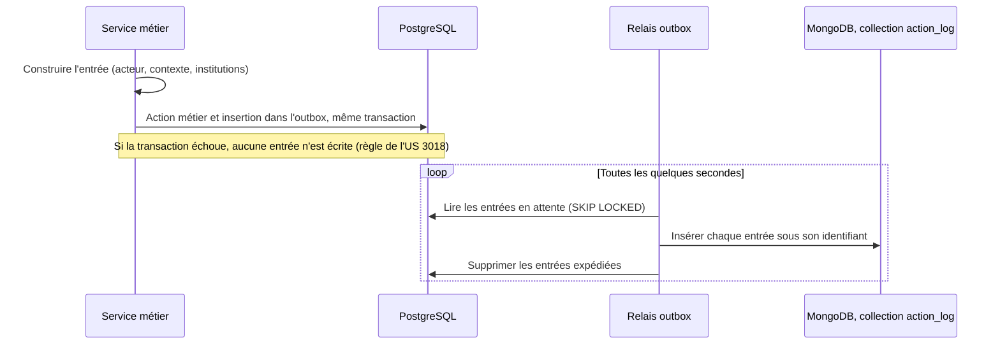

- **Sans attente pour le code métier** : il n'attend ni MongoDB ni le relais.
- **Sans perte** : l'entrée est envoyée si et seulement si la transaction métier est validée, ce qui respecte [#3018] : "le log est créé uniquement lorsque l'action a effectivement été réalisée et enregistrée".
- **Au moins une fois** : si le relais s'arrête au mauvais moment, une entrée peut être renvoyée ; l'insertion sous l'identifiant de l'entrée rend le doublon sans effet.
- **Plusieurs instances** : chaque instance du relais verrouille des lignes différentes (`FOR UPDATE SKIP LOCKED`), sans attendre les autres ([§6.2](#instances)).
- Le même relais transporte les confirmations de gel, les suppressions de détenteurs ([§2.8](#coherence)) et les suppressions d'objets S3 ([§4.3](#nettoyage)).

> **Pourquoi pas plus simple ?** Un écouteur Spring déclenché après le commit (`@TransactionalEventListener`) éviterait la table et le relais. Mais l'entrée n'existe alors qu'en mémoire : si MongoDB est indisponible à ce moment-là, ou si l'instance s'arrête entre le commit et l'envoi (un déploiement remplace les instances, C13), elle est perdue, et rien ne la rejoue. L'outbox coûte une table et un traitement planifié, et ne perd rien.
> 
> **Pratique de référence.** C'est le patron *transactional outbox* (microservices.io) : écrire l'événement dans la même transaction que la donnée, puis le publier par un relais. Le relais livre au moins une fois ; le destinataire est un *idempotent consumer*, qui ignore un message déjà reçu grâce à son identifiant.

### 5.5 Une entrée par action, sans regroupement à l'écriture {#regroupement}

Faut-il fusionner des événements rapprochés et semblables ? **Non, pas dans le journal de référence.**
- [#3018], critère 1 : "plusieurs actions successives donnent lieu à des logs distincts lorsqu'elles correspondent à plusieurs événements devant être historisés". Le critère 2 demande en plus l'heure de chaque action, à la seconde.
- Un journal d'audit sert de preuve : chaque entrée décrit une action, est écrite une fois et n'est jamais modifiée. Fusionner à l'écriture obligerait à retarder l'écriture ou à réécrire une entrée existante.
- L'agrégation existe : le NIST la définit comme la consolidation d'entrées similaires en une seule, qui porte le nombre d'occurrences. C'est une technique de réduction du volume ; appliquée ici, elle ferait perdre l'heure de chaque action.
- Le vrai sujet est l'enregistrement automatique : une sauvegarde toutes les 5 secondes n'est pas une action à journaliser. Par défaut, **les enregistrements automatiques ne produisent aucune entrée** (HF7). Le suivi des modifications de contenu passe par l'historique de travail (phase 2), où chaque version a un auteur, ce que demande [#2842].
- Si une US exige un jour de journaliser une édition, l'événement sera défini à une étape significative (création d'une version, envoi, publication, etc.), jamais à chaque enregistrement.
- Le regroupement reste possible **à l'affichage** : un outil de consultation peut présenter "3 modifications entre 14 h 02 et 14 h 04" à partir des entrées brutes.

### 5.6 Catalogue initial {#catalogue}

| Événement | Nature | Objet | Utilisateur concerné | Détails | US |
| --- | --- | --- | --- | --- | --- |
| `TRACE_CREATED` | ajout | trace | - | - | [#1191] |
| `TRACE_UPDATED` | modification | trace | - | noms des champs modifiés | [#1191] |
| `TRACE_DELETED` | suppression | trace | - | - | [#1191] |
| `TRACE_ASSOCIATED`, `TRACE_DISSOCIATED` | ajout, suppression | trace | - | élément associé ou dissocié (type, identifiant) | [#1191] |
| `ACTIVITY_RIGHT_GRANTED`, `_UPDATED`, `_REVOKED` | ajout, modification, suppression | droit sur l'activité | membre STAFF concerné | droits avant et après | [#3023] |
| `ACTIVITY_DELETED` | suppression | activité | - | titre de l'activité : une fois l'activité supprimée, son identifiant seul ne permet plus de la reconnaître ; droit exercé | [#2791] |
| Événements du versionnement : `CAPTURE_CREATED`, `FREEZE_RELEASED`, `RETENTION_DEADLINE_SET`, `CAPTURE_DELETED`, `VERSION_DELETED`, `FILE_DELETED`, `RETENTION_POLICY_CHANGED` | selon le cas | capture, version, fichier, politique | - | politique et révision appliquées, jamais le contenu | socle |

Les événements du versionnement ont l'acteur `SYSTEM` quand ils viennent d'un traitement (purge, réconciliation). Ils permettent de répondre, pour toute capture : par quelle action a-t-elle été figée, au nom de quel détenteur, selon quelle politique, jusqu'à quand, et quand a-t-elle été supprimée. `VERSION_RESTORED` arrivera avec la restauration (phase 2). L'éligibilité à la purge n'est pas journalisée : elle se déduit de l'échéance, déjà tracée par `RETENTION_DEADLINE_SET`.

### 5.7 Rétention, archivage et accès {#retention-journal}

| Étape | Défaut proposé | Paramètre |
| --- | --- | --- |
| Consultable dans MongoDB | 3 mois | `cofolio.action-log.hot-retention` |
| Puis archive compressée en lecture seule dans S3 (un fichier par mois) | jusqu'à 12 mois au total | `cofolio.action-log.retention` |
| Purge des archives | à 12 mois | `cofolio.action-log.retention` |

- **Durée.** La CNIL recommande de conserver les journaux de 6 mois à 1 an, et jusqu'à 3 ans si c'est justifié. La durée finale est à fixer, éventuellement par type d'événement.
- **Archivage.** Chaque mois, un traitement exporte dans S3 le mois qui dépasse la durée de consultation, vérifie l'export, puis supprime ces entrées de MongoDB. C'est le "freeze des logs" évoqué pendant les échanges : les entrées anciennes quittent la base, restent consultables à la demande et ne sont plus modifiables.
- **Expiration.** Le champ `expiresAt` porte la fin de la rétention totale, calculée à l'écriture, ce qui permet une durée par type d'événement. Un index TTL sur ce champ garantit qu'aucune entrée ne reste dans MongoDB au-delà, même si l'archivage est en panne ; la tâche de fond de MongoDB passe toutes les 60 secondes, sans garantie de délai. La purge quotidienne supprime les archives dont toutes les entrées sont échues.
- **Accès.** SUPER ADMIN et développeurs autorisés ([#1191], critère 3), sans accès pour les administrateurs d'établissement ni pour les apprenants. La consultation du journal peut elle-même être journalisée.
- **Reporting.** C'est une autre finalité : il se fera sur des données agrégées ou anonymisées, pas sur le journal.

> **Version minimale acceptable.** Si l'on veut alléger la phase 1, l'archivage peut attendre : toutes les entrées restent dans MongoDB jusqu'à 12 mois et l'index TTL les supprime ensuite. Le format ne change pas, et l'archivage pourra s'ajouter plus tard. Il se justifie quand le volume rend la collection lourde à indexer, ou quand on veut des entrées anciennes impossibles à modifier (archives S3 protégées par Object Lock).

### 5.8 Index {#index-journal}

| Index | Usage |
| --- | --- |
| `{ occurredAt: -1 }` | Parcours par période |
| `{ "actor.id": 1, occurredAt: -1 }` | Actions d'un utilisateur |
| `{ relatedUserId: 1, occurredAt: -1 }` | Actions qui concernent un utilisateur |
| `{ "target.type": 1, "target.id": 1, occurredAt: -1 }` | Historique d'un objet |
| `{ "context.activityId": 1, occurredAt: -1 }` | Actions sur une activité |
| `{ "context.institutionIds": 1, occurredAt: -1 }` | Actions dans une institution |
| `{ type: 1, occurredAt: -1 }` | Un type d'événement |
| `{ correlationId: 1 }` | Entrées d'une même requête |
| `{ expiresAt: 1 }`, avec `expireAfterSeconds: 0` | Expiration (TTL) |

### 5.9 Autres services et corrélation {#services}

**Un format partagé.** Le format de l'entrée (`ActionLogEntry`), l'interface `ActionLogPublisher` et la construction du contexte (acteur, institutions, origine) vont dans `avenirs-portfolio-common`, déjà partagé par l'API, le back-office et l'interopérabilité (C14). L'implémentation (table outbox et relais) vit dans chaque service qui journalise, dans sa propre base : en phase 1, seulement l'API. Le back-office l'adoptera quand une US le demandera (actions d'administration sur les institutions, les groupes, les CGU, etc.). Toutes les entrées arrivent dans la même collection `action_log`, et `origin` indique le service.

**Un identifiant de requête.** Un filtre (HTTP) attribue à chaque requête un identifiant (UUID), le place dans le MDC de Logback, ce qui l'ajoute à chaque ligne de log technique, et dans le contexte de requête. Chaque entrée du journal le reprend dans `correlationId`. Un traitement planifié utilise l'identifiant de son exécution. On passe ainsi d'une entrée du journal aux logs techniques de la même requête, et inversement, sans mettre de contenu dans le journal.

> **Pratique de référence.** La recommandation W3C *Trace Context* définit l'en-tête `traceparent`, qui transporte un identifiant de trace d'un service à l'autre. Si l'observabilité de COFOLIO l'adopte un jour (OpenTelemetry, par exemple), cet identifiant pourra servir de `correlationId` ; en phase 1, l'API génère le sien, sans traçage distribué.

## 6. Phase 1 : purge, traitements planifiés, paramétrage et RGPD {#purge}

### 6.1 Ce que fait la purge {#purge-phase-1}

Un traitement quotidien, par lots, avec un mode simulation (toujours mieux pour éviter les erreurs) qui produit un rapport sans rien supprimer :
1. **Captures** : celles dont tous les gels sont libérés ou échus sont supprimées. La suppression est conditionnelle : elle n'a lieu que si les gels sont toujours dans l'état lu.
2. **Versions** : celles qu'aucune capture restante ne référence, sans gel direct et dont le bail est expiré.
3. **Gels orphelins** : la réconciliation, toutes les 15 minutes, examine les gels `PENDING` plus anciens qu'une heure ; elle les confirme si PostgreSQL référence la capture, sinon elle les libère (`ORPHAN`).
4. **Fichiers** : nettoyage décrit au [§4.3](#nettoyage).
5. **Journal** : archivage et expiration ([§5.7](#retention-journal)).

Chaque suppression produit une entrée minimale dans le journal : identifiants, politique et révision appliquées, jamais le contenu. On peut ainsi retrouver pourquoi une capture a été supprimée sans conserver ce qu'elle contenait.

### 6.2 Traitements planifiés et instances multiples {#instances}

Plusieurs instances de l'API peuvent tourner en même temps (C13). Chaque traitement est donc conçu pour qu'une exécution concurrente soit sans danger :

| Traitement | Fréquence | Avec plusieurs instances |
| --- | --- | --- |
| Relais outbox | toutes les quelques secondes | Chaque instance prend des lignes différentes (`FOR UPDATE SKIP LOCKED`) ; un envoi en double est sans effet |
| Réconciliation des gels | toutes les 15 minutes | Mises à jour conditionnelles et idempotentes : deux exécutions donnent le même résultat |
| Purge des captures et des versions | quotidienne | Suppressions conditionnelles (l'état relu doit être inchangé) |
| Nettoyage des fichiers | quotidien | Suppression conditionnelle de la ligne `file` ; objet S3 supprimé par le relais |
| Archivage du journal | mensuel | Une archive par mois, au nom déterministe : une seconde exécution réécrit le même fichier |

Pour éviter le travail en double, les traitements autres que le relais prennent un verrou au démarrage : verrou consultatif PostgreSQL, sans dépendance nouvelle, ou bibliothèque ShedLock, courante avec Spring. La synchronisation actuelle du référentiel de compétences en profiterait aussi.

> **Pratique de référence.** PostgreSQL documente `SKIP LOCKED` comme le moyen de passer les lignes déjà verrouillées sans attendre : c'est la façon classique de répartir une file d'attente stockée en base entre plusieurs consommateurs.

### 6.3 Paramétrage {#parametrage}

Les paramètres techniques sont dans le fichier `.properties` de l'API, avec des valeurs par défaut globales et une surcharge possible par type d'élément :

```properties
# Versionnement, phase 1 (valeurs proposées)
cofolio.versioning.freeze.pending-timeout=PT1H
cofolio.versioning.reuse-lease=PT1H
cofolio.versioning.reconciliation.cron=0 */15 * * * *
cofolio.versioning.purge.cron=0 15 3 * * *
cofolio.versioning.purge.batch-size=500
cofolio.versioning.purge.dry-run=false

# Versions temporaires, phase 2 (valeurs proposées)
cofolio.versioning.rich-text.snapshot-interval=PT15M
cofolio.versioning.rich-text.thinning[0].until=PT24H
cofolio.versioning.rich-text.thinning[0].bucket=PT15M
cofolio.versioning.rich-text.thinning[1].until=P7D
cofolio.versioning.rich-text.thinning[1].bucket=PT1H
cofolio.versioning.rich-text.thinning[2].until=P30D
cofolio.versioning.rich-text.thinning[2].bucket=P1D
cofolio.versioning.rich-text.thinning[3].until=P90D
cofolio.versioning.rich-text.thinning[3].bucket=P7D
cofolio.versioning.rich-text.temporary-retention=P90D
cofolio.versioning.file.temporary-retention=P30D
cofolio.versioning.file.max-temporary-versions=5
# Surcharge par type d'élément, par exemple :
# cofolio.versioning.types.REFLECTION.rich-text.snapshot-interval=PT10M

# Fichiers
cofolio.files.gc.grace=PT24H

# Journal d'actions
cofolio.action-log.hot-retention=P3M
cofolio.action-log.retention=P12M
```

Le délai d'enregistrement automatique du bilan reste une constante du front (5 secondes). Les durées des gels ne sont **pas** dans ce fichier : elles appartiennent aux politiques ([§6.4](#politiques)). Modifier la configuration ne doit jamais changer en silence l'échéance d'un gel existant.

### 6.4 Politiques de conservation {#politiques}

- Les politiques sont stockées dans `retention_policies`, identifiées par un code et une révision, créées par migration et jamais modifiées manuellement : un changement crée une nouvelle révision.
- Un gel garde le code et la révision de sa politique. Une nouvelle révision ne s'applique qu'aux nouveaux gels, sauf migration explicite et journalisée qui recalcule les échéances.
- Phase 1 : `FEEDBACK_REQUEST`, `ASSESSMENT_SUBMISSION` et `COMPLETION`. Plus tard : `PUBLICATION` ([#2844]), un éventuel plafond ([§2.4](#gels)), `DELETED_RESOURCE` pour une corbeille ([§9.3](#corbeille)).

```json
{
  "_id": "FEEDBACK_REQUEST@1",
  "code": "FEEDBACK_REQUEST",
  "revision": 1,
  "referenceEvent": "EVENT_DATE",
  "event": "HOLDER_DELETED",
  "duration": "P0D",
  "deletionMode": "ELIGIBLE_FOR_PURGE",
  "effectiveFrom": "2026-12-01T00:00:00Z",
  "effectiveUntil": null
}
```

### 6.5 RGPD et suppressions {#rgpd}

Il faut distinguer quatre choses : la suppression fonctionnelle (l'utilisateur supprime un élément), la conservation obligatoire, la suppression des versions et l'effacement physique.

Appliqué à COFOLIO :

| Cas | État courant | Versions et captures | Journal |
| --- | --- | --- | --- |
| L'apprenant supprime une trace | Supprimée | Ses versions restent dans les captures figées tant que leurs détenteurs existent ; le front l'annonce déjà : la trace "restera consultable depuis" l'activité | `TRACE_DELETED` |
| Un détenteur est supprimé : feedback, réalisation (seule ou avec son activité, [#1189]) | Supprimé | Gels échus après le délai de grâce, puis purge | Entrée de l'action, puis `CAPTURE_DELETED` |
| Désinscription d'une activité | Demandes de feedback en attente supprimées | Leurs gels prennent fin, puis purge | Entrée de l'action, puis `CAPTURE_DELETED` |
| Compte supprimé ou demande d'effacement (aucune US à ce jour) | Supprimé | Effacement de toutes les versions et captures de la personne (`eraseByOwnership`), gels compris (`DELETED`), sauf obligation légale de conservation (à préciser) | Conservé jusqu'à son échéance : identifiants seuls, sans contenu |
| Compte STAFF supprimé | - | Les versions d'activités restent, comme contenu de l'établissement ; l'auteur n'y figure que par son identifiant | Idem |

Principes dans le cas d'un apprenant, rattachés au RGPD :
- **Finalités distinctes** : preuve de ce qui a été transmis et évalué (captures), sécurité et traçabilité (journal), statistiques (hors périmètre).
- **Minimisation** : pas de contenu dans le journal, pas d'entrée par enregistrement automatique. Pas non plus de "dernière version anonymisée" : un texte libre ne s'anonymise pas automatiquement.
- **Limitation de la conservation** : la durée des captures suit celle des données de l'apprenant, à fixer (fin de cursus, inactivité ?) ; celle du journal est paramétrable, 12 mois par défaut.
- **Droits des personnes** : les captures font partie des données de l'apprenant et doivent figurer dans la réponse à une demande d'accès ; l'effacement passe par `eraseByOwnership`. Aucune US ne couvre encore la suppression de compte ni l'export des données ; le socle les rend possibles, grâce au propriétaire (`ownerId`) porté par chaque version et chaque capture.
- **Information** : les apprenants doivent savoir que ce qu'ils transmettent est conservé, même s'ils suppriment ensuite l'élément, comme c'est déjà annoncé pour les traces.
- **Protection dès la conception** : les durées sont paramétrables, l'effacement par personne est prévu dès la phase 1.

## 7. Phase 1 : impacts, migration et lots {#impacts}

### 7.1 Back-end {#impacts-back}

| Composant | Changement | Phase |
| --- | --- | --- |
| Nouveau module `versioning` | Port `VersioningService`, codecs par type d'élément, adaptateur MongoDB, réconciliation, purge | 1 |
| Nouveau module `actionlog` | Implémentation d'`ActionLogPublisher`, collection `action_log`, archivage | 1 |
| `avenirs-portfolio-common` | Format `ActionLogEntry`, interface `ActionLogPublisher`, filtre d'identifiant de requête et MDC | 1 |
| Outbox et relais, communs aux deux modules | Table outbox et relais planifié : confirmations de gel, suppressions de détenteurs, entrées du journal, suppressions d'objets S3 | 1 |
| Demandes de feedback (`FeedbackServiceImpl`) | Capture à l'envoi et au renvoi ; `feedback.capture_id` remplace les colonnes `reflection` et `associations` ; détail lu depuis la capture | 1 |
| Soumission et évaluation (`DeclaredActivityServiceImpl`) | Verrou sur la réalisation ; capture à la soumission ; colonnes `assessment_submission_id` et `assessment_capture_id` ; `getAssessmentDetails` lit la capture | 1 |
| Fin de réalisation (`finish`) | Capture `COMPLETION` ; colonne `completion_capture_id` | 1 |
| Suppressions : réalisation, activité ([#1189]), feedbacks, désinscription | Événement `HOLDER_DELETED` écrit dans l'outbox | 1 |
| Fichiers (`FileResourceService`) | Empreinte SHA-256, registre `file_usage`, nettoyage ; les appels directs à `fileResourceService.delete` deviennent des retraits d'usage (C10) | 1 |
| Traces | Retrait de `findAttachmentIdsUsedByTraceSnapshots` ; événements de [#1191] | 1 |
| Droits sur les activités | Événements de [#3023] | 1 |
| Traitements planifiés | Verrou d'exécution ([§6.2](#instances)) | 1 |
| Éléments édités | Révision, auteur du dernier enregistrement, concurrence optimiste (`If-Match`) | 2 |

### 7.2 Migration des feedbacks existants {#migration}

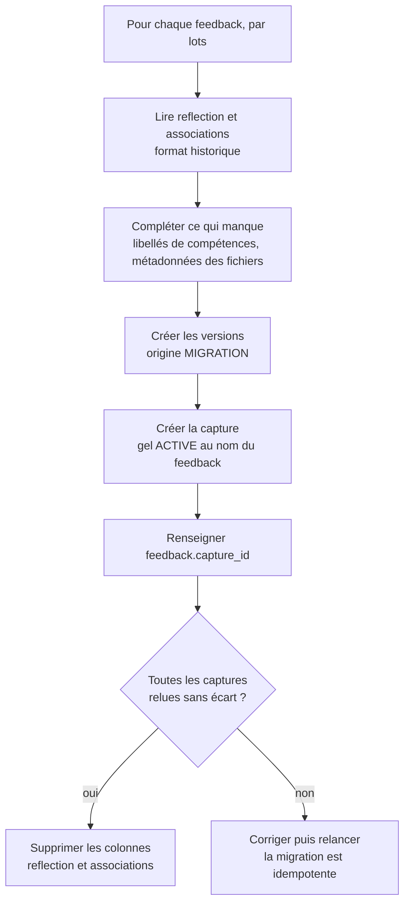

- La migration est **idempotente** (identifiant de capture dérivé de celui du feedback), reprenable et accompagnée d'un rapport.
- Les versions créées portent l'origine `MIGRATION` et le format historique ; un codec dédié les met au format courant à la lecture ([§2.9](#format)).
- **Limite connue** : les données absentes de l'ancienne copie (libellés de compétences, métadonnées de fichiers) sont complétées à partir de l'état courant au moment de la migration.
- Les pièces jointes des anciennes copies deviennent des références de versions : le nettoyage les conserve.
- Les colonnes ne sont supprimées qu'après validation.

### 7.3 Front-end {#impacts-front}

- Forcer l'enregistrement en attente avant "Demander un feedback", "Soumettre" et "Terminer" (C7).
- Écrans de consultation du STAFF inchangés : mêmes DTO.
- Si le PO le confirme, écrans de l'apprenant pour une réalisation soumise ou terminée lus depuis la capture ([§2.6](#lecture)).
- Phase 2 : envoyer la révision attendue (`If-Match`) et gérer le conflit (HttpError 412) ; écrans d'historique et de restauration ([#1320]).

## 8. Phase 2 : historique de travail et restauration {#phase-2}

### 8.1 Rappel {#phase-2-besoin}

- **Besoins :**
  - [#1320] : Restaurer une version d'une trace ; V3, US encore à rédiger.
  - [#2842] : "chaque modification enregistrée est associée à l'utilisateur qui l'a réalisée", retrouver un état antérieur du bilan, annuler après un rafraîchissement.
- **Hypothèses :** HF9, HF10, HT2, HT3.
- **Constat :** C7 (aucun numéro de révision).

La phase 2 ajoute des versions là où la phase 1 n'en crée que lors d'un gel. Les collections, les codecs, les gels, la purge, le registre d'usages et le format du journal ne changent pas ([§8.7](#phase-2-inchange)).

### 8.2 Versions temporaires {#versions-temporaires}

| Mode d'édition | Exemples | Création d'une version temporaire |
| --- | --- | --- |
| Enregistrement continu | bilan, futures pages libres ([#2842]) | Au plus une par fenêtre de 15 minutes et par auteur, si le contenu a changé depuis la dernière version |
| Enregistrement explicite (formulaire) | trace ([#1320]), compétence déclarée, expérience, formation | À chaque enregistrement qui change le contenu |
| Remplacement d'un fichier | pièce jointe d'une trace | L'ancien fichier reste référencé par la version précédente de son propriétaire ([§8.6](#fichiers-phase-2)) |

Règles :
- **Un seul auteur par version.** Quand un autre auteur enregistre, l'état courant est d'abord versionné au nom de l'auteur précédent s'il a changé depuis la dernière version ; une nouvelle version commence. C'est ce qui permet de "distinguer les modifications effectuées par les différents auteurs" ([#2842]). Cela demande de connaître l'auteur du dernier enregistrement, que l'audit JPA ne fournit pas aujourd'hui (C9).
- **Rien n'est perdu entre deux versions** : les dernières minutes de saisie sont dans l'état courant, et toute action qui fige ou restaure versionne d'abord l'état courant.
- **Pas de version pour un contenu identique** (même empreinte).
- Une capture peut réutiliser une version temporaire si l'élément n'a pas changé depuis : cette version devient figée par la capture et n'est plus éclaircie.

> **Pourquoi pas une version par enregistrement automatique ?** Un enregistrement à chaque pause de 5 secondes dans la saisie produirait des dizaines, voire des centaines, de versions par heure, sans intérêt pour l'utilisateur, qui veut revenir à "l'état d'il y a un quart d'heure", pas à celui d'il y a 5 secondes. Pour une trace, enregistrée explicitement, chaque enregistrement est au contraire une étape voulue.
> 
> **Pratique de référence.** WordPress distingue la sauvegarde automatique (une par utilisateur, écrasée à chaque fois) des révisions ; Google Docs fusionne parfois des révisions rapprochées, mais jamais les versions nommées. Les versions temporaires suivent la même logique : peu de versions pendant la saisie, aucune perte pour ce qui est figé.

### 8.3 Éclaircissement {#eclaircissement}

| Ancienneté | Textes riches | Fichiers |
| --- | --- | --- |
| 0 à 24 h | une version par tranche de 15 min | dans la limite du quota |
| 24 h à 7 jours | une version par heure | dans la limite du quota |
| 7 à 30 jours | une version par jour | 30 jours au plus |
| 30 à 90 jours | une version par semaine | purge des versions temporaires |
| Au-delà de 90 jours | purge des versions temporaires | purge des versions temporaires |

Pour les fichiers, deux limites se cumulent : 5 versions temporaires au plus et 30 jours au plus, la plus restrictive s'appliquant. Les éléments structurés enregistrés par formulaire (traces, etc.) suivent les paliers des textes riches. Ces valeurs sont des paramètres initiaux, à ajuster après mesure des usages.

L'algorithme est celui des outils de sauvegarde : le temps est découpé en tranches calendaires (heure, jour, semaine), calculées en UTC pour que le résultat ne dépende pas du fuseau du serveur ; on garde la version la plus récente de chaque tranche, et un nouveau passage donne toujours le même résultat. Les versions figées ne sont jamais touchées et ne comptent pas dans les quotas.

> **Faut-il rejouer des modifications pour ne garder qu'une version par semaine ?** Non. Comme chaque version est complète, garder une version par semaine revient à garder la dernière version de la semaine et à supprimer les autres. Google Drive fait de même : il supprime les anciennes révisions d'un fichier, conservées en général 30 jours ou dans la limite de 100, sauf celles marquées "Conserver indéfiniment".
> 
> **Pratique de référence.** C'est la rotation des sauvegardes (schéma grand-père, père, fils), et `restic forget` avec ses options `--keep-hourly`, `--keep-daily` et `--keep-weekly` : garder le dernier instantané de chaque période, de plus en plus espacé avec l'âge.

### 8.4 Révision et concurrence optimiste {#concurrence}

- Chaque élément édité reçoit une colonne `revision`, augmentée à chaque enregistrement (`@Version` de JPA).
- L'API renvoie la révision dans l'en-tête `ETag` ; le front la renvoie dans `If-Match` à chaque enregistrement, restauration ou action qui fige.
- Si la révision ne correspond plus, l'API refuse avec la réponse `412 Precondition Failed`, au lieu d'écraser une modification faite ailleurs ; le front propose de recharger.
- Une requête sans `If-Match` reste acceptée le temps d'adapter le front, puis est refusée (`428 Precondition Required`).

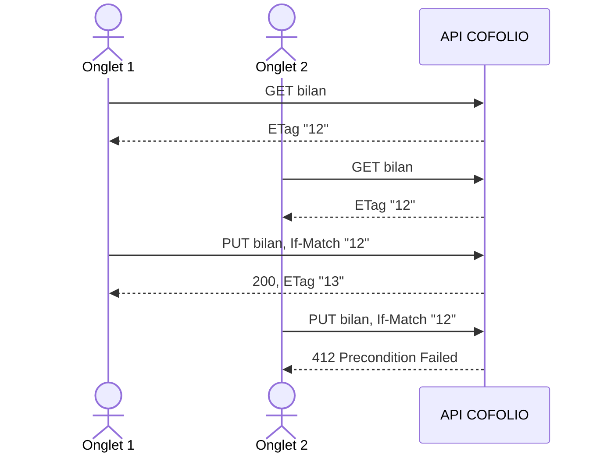

> **Pratique de référence.** Ce sont les requêtes conditionnelles de HTTP (RFC 9110 pour `If-Match` et la réponse 412 ; la réponse 428 est définie par la RFC 6585), associées au verrouillage optimiste de JPA. Elles suppriment le risque évoqué en phase 1 : figer une modification faite dans un autre onglet sans l'avoir vue.

### 8.5 Restaurer une version précédente {#restauration}

- **Quoi** : une version d'un élément (trace pour [#1320], bilan, page libre, etc.), temporaire ou figée.
- **Comment** : la restauration crée une nouvelle révision dont le contenu est celui de la version choisie, mis au format courant. La version source n'est jamais modifiée.
- **Sans perte** : l'état courant est enregistré comme version juste avant ; on peut donc toujours revenir en arrière, y compris sur une restauration.
- **Concurrence** : la restauration transmet la révision attendue et est refusée si l'élément a changé entre-temps.
- **Droits et traçabilité** : ceux de la modification de l'élément ; entrée `VERSION_RESTORED` dans le journal (version source, nouvelle révision).
- **Pour une trace** : ses associations ne changent pas, car elles ne font pas partie de la version de la trace ; ce qui a été transmis dans une activité reste dans sa capture. La pièce jointe de la version est de nouveau rattachée, ce qui est toujours possible, puisqu'un fichier référencé par une version n'est jamais supprimé.

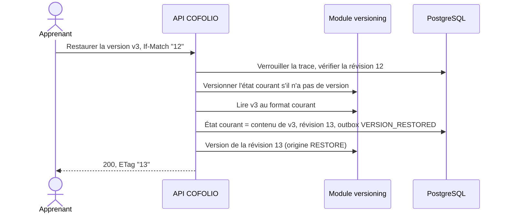

> **Pratique de référence.** Restaurer revient à créer un nouveau commit qui reprend le contenu d'un ancien, plutôt qu'à faire un `git reset`, qui réécrirait l'historique. L'historique reste linéaire et complet.

### 8.6 Fichiers en phase 2 {#fichiers-phase-2}

Si une US demande de retrouver une pièce jointe remplacée, l'ancien fichier reste disponible comme version temporaire, dans la limite de 5 versions et de 30 jours. Le registre et le nettoyage ne changent pas : le fichier est simplement référencé par une version temporaire.

### 8.7 Ce qui ne change pas {#phase-2-inchange}

La phase 2 étend les ports sans modifier les méthodes existantes :

```java
public interface VersioningService {
  // ... méthodes de la phase 1, inchangées

  /** Phase 2 : appelé à chaque enregistrement ; crée une version temporaire si les règles le demandent. */
  void onSaved(ResourceRef resource, Object content, Actor author, long revision);

  /** Phase 2 : historique d'un élément, du plus récent au plus ancien. */
  Page<VersionSummary> history(ResourceRef resource, Pageable pageable);

  /** Phase 2 : contenu d'une version, au format courant. */
  <T> T readVersion(UUID versionId, Class<T> type);
}
```

| Brique | Changement en phase 2 |
| --- | --- |
| Collections `versions`, `captures`, `retention_policies` | Aucun : les versions temporaires sont des versions sans gel, d'origine `AUTO` ou `RESTORE` |
| Codecs et mise à niveau à la lecture | Aucun |
| Gels et politiques | Aucun |
| Purge | Une étape de plus : l'éclaircissement |
| Registre d'usages et nettoyage | Aucun |
| Journal | Un événement de plus : `VERSION_RESTORED` |
| Tables métier | Colonnes `revision` et auteur du dernier enregistrement sur les éléments édités |

## 9. Phase 3 et au-delà {#phase-3}

### 9.1 Publication d'une page libre ([#2844]) {#publication}

Si la page publiée doit rester consultable telle qu'elle a été publiée pendant que ses auteurs la modifient, la publication crée une version de la page et un gel `PUBLICATION`, dont le détenteur est la publication. L'échéance part de la dépublication : tant que la page est publiée, l'événement attendu n'est pas survenu et la version reste protégée. Un nouveau détenteur, une nouvelle politique, le même mécanisme.

### 9.2 Restaurer une réalisation entière {#restauration-capture}

Si une US le demande, la restauration se fait en cascade, sans jamais écraser un élément qui existe encore :

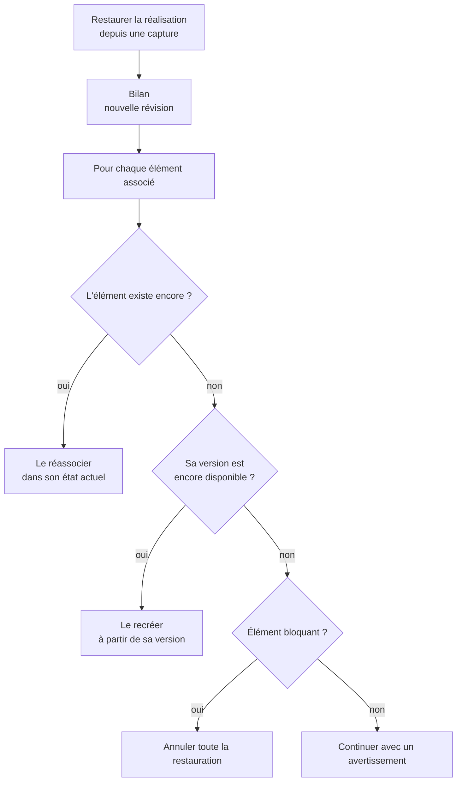

### 9.3 Restaurer un élément supprimé {#corbeille}

- Il faudrait garder la dernière version d'un élément supprimé pendant un temps donné : une politique `DELETED_RESOURCE` (échéance à la suppression plus N jours) ferait office de "corbeille".
- Les tables métier restent sans suppression logique : le mécanisme vit entièrement dans le versionnement (C6).
- À préciser quand une US le demandera : durée, droits, sort des associations.

### 9.4 Comparer deux versions {#comparaison}

La comparaison se calcule à la lecture à partir de versions complètes (différences de texte, de champs, etc.), sans rien stocker de plus. Stocker des différences ne serait qu'une "optimisation" interne.

### 9.5 Annulation et édition simultanée {#edition}

- **Annuler et rétablir après un rafraîchissement.** L'historique d'annulation de l'éditeur vit en mémoire et disparaît au rechargement, comme dans la plupart des éditeurs. Le conserver dans le navigateur ne vaudrait que pour un appareil. La réponse durable est l'historique de travail : restaurer la version d'il y a un quart d'heure.
- **Co-construction ([#2842]).** Plusieurs auteurs enregistrent tour à tour la même page. Il faut la concurrence optimiste ([§8.4](#concurrence)) pour ne pas écraser le travail d'un autre, et des versions attribuées à un seul auteur ([§8.2](#versions-temporaires)). Ce n'est pas encore de l'édition simultanée.
- **Édition simultanée** (V3 ou au-delà). Elle passerait par un document partagé synchronisé en temps réel, par exemple avec Yjs, ce qui change la façon de stocker le texte riche. Le socle reste compatible : on versionne le document à intervalles réguliers et lors des gels ; le nouveau format est un nouveau codec.

### 9.6 Référentiels versionnés ([#2939]) {#referentiels}

Des versions publiées, numérotées et consultées en permanence par les fonctionnalités relèvent du modèle métier (tables dédiées dans PostgreSQL), pas de l'historique. COFOLIO en a déjà un exemple : le back-office garde chaque version des CGU (fichier, numéro, date de dépôt) et l'API enregistre, pour chaque utilisateur, la version acceptée et sa date. Les principes sont les mêmes que ceux du socle : immuabilité, identifiants stables, pas de modification rétroactive. Les captures enregistreront, pour chaque compétence, la version du référentiel utilisée.

### 9.7 Consultation d'une évaluation ([#3163]) {#consultation-evaluation}

C'est d'abord une question fonctionnelle. Aujourd'hui, l'évaluation porte ses dates d'envoi (`assessedAt`), de dernière modification (`modifiedAt`) et de consultation par l'apprenant (`studentConsultedAt`) : on sait donc si l'apprenant a vu la dernière version, c'est ce qui décide de la notification de modification. Savoir quelle version il a vue demanderait de versionner l'évaluation, ce que [#1311] exclut ; sa consultation deviendrait alors un gel ou une entrée du journal. Les lectures ne sont pas journalisées par défaut, par minimisation.

## Annexe {#annexe}

### Pratiques et standards de référence {#annexe-pratiques}

Chaque proposition reprend une pratique établie, adaptée au projet :

| Approche dans la RFC | Pratique ou standard | Ce qui est repris | Écart assumé |
| --- | --- | --- | --- |
| Format du texte riche | Éditeur WYSIWYG Tiptap : export HTML ou JSON ; OWASP : nettoyage du HTML par DOMPurify | Versionner le HTML tel qu'il est stocké ; afficher une version avec le même nettoyage | Pas de normalisation du HTML avant l'empreinte : deux HTML équivalents donnent deux versions, sans risque |
| Versions complètes, différences calculées à la demande | Git (commits = instantanés) ; WordPress (révisions complètes) | Versions complètes | Pas de compression par différences : inutile aux volumes attendus (pour le moment) |
| Version composite | Git : commit, arborescence, objets | Capture = manifeste de versions | Identifiant (UUID) plutôt que l'empreinte : effacement par personne |
| Réutilisation d'un contenu inchangé | Git (objets identifiés par leur contenu) ; restic (déduplication) | Réutilisation de la dernière version d'un élément quand l'empreinte ne change pas | Pas de déduplication entre utilisateurs |
| Protections cumulables | *Holds* des outils de gestion documentaire ; *legal hold* de S3 Object Lock | Gels avec détenteur et motif, cumulables | Statut unique de S3 jugé insuffisant |
| Conservation qui démarre à un événement | Microsoft Purview : rétention déclenchée par un événement | Échéance à la suppression du détenteur | Plafond éventuel à valider |
| Éclaircissement par tranches de temps | Rotation des sauvegardes ; `restic forget` ; Google Drive (30 jours ou 100 révisions, "Conserver indéfiniment") | Paliers horaires, quotidiens, hebdomadaires ; versions figées jamais touchées | - |
| Sauvegarde automatique distincte des versions | WordPress (une sauvegarde automatique par utilisateur) ; Google Docs (révisions fusionnées, sauf versions nommées) | Au plus une version temporaire par quart d'heure et par auteur | - |
| Évolution du format des données conservées | MongoDB *Schema Versioning* ; *upcasting* d'Axon Framework | Mise à niveau à la lecture | Migration explicite possible, à titre exceptionnel |
| Empreinte d'un document JSON | JSON canonique | Empreinte des versions structurées | - |
| Action métier et événement fiables | *Transactional outbox* ; *idempotent consumer* (microservices.io) | Outbox PostgreSQL et relais ; insertion sous l'identifiant de l'entrée | - |
| Réserver puis confirmer entre deux systèmes | *Try-Confirm-Cancel* | Gel `PENDING`, puis `ACTIVE` ; réconciliation | Annulation par la réconciliation, après délai, plutôt que par l'initiateur ; transaction PostgreSQL ouverte pendant l'écriture MongoDB (courte, avec délai maximal) |
| Réservation limitée dans le temps | Bail (*lease*) | Bail d'une heure sur une version réutilisée | - |
| Contenu avant référence ; délai de grâce | Git : objets écrits avant les références ; `git gc` : délai de deux semaines par défaut | Capture écrite avant sa référence ; fichiers nettoyés après 24 heures, ligne `file` supprimée avant l'objet S3 | Délai plus court : nos écritures durent quelques secondes |
| Journal d'audit | OWASP (*Logging Cheat Sheet*, *Logging Vocabulary*) ; CNIL (6 mois à 1 an) ; NIST (agrégation : réduction du volume au prix du détail) | Une entrée par action, sans contenu, nommage `OBJET_VERBE`, date ISO 8601 en UTC | Regroupement seulement à l'affichage |
| Identifiant de corrélation | W3C *Trace Context* | `correlationId` dans le journal et dans les logs techniques | Pas de traçage en phase 1 |
| File d'attente en base, plusieurs consommateurs | PostgreSQL `SKIP LOCKED` | Relais outbox sur plusieurs instances | - |
| Concurrence optimiste | HTTP : `ETag`, `If-Match`, 412 (RFC 9110), etc. ; JPA `@Version` | Phase 2 | - |
| Fichiers stockés une fois, une ligne par usage | Moodle *File API* | Registre `file_usage` | Pas de partage de contenu entre utilisateurs |

Alternatives examinées et écartées pour le socle (détail dans la [synthèse](../rfc-versionnement-historisation#alternatives)) :
- **Hibernate Envers** : audit des entités JPA, avec des révisions par transaction et des requêtes sur l'état à une révision donnée. Pertinent pour un historique de travail d'entités simples ; inadapté aux captures (pas de gel, pas de conservation par motif, tables d'audit à faire évoluer avec le modèle).
- **Event sourcing** : stocker toutes les modifications comme une suite d'événements. Il donnerait l'historique par construction, *mais imposerait de réécrire la persistance de tous les modules*.

### Pseudo-code {#annexe-pseudocode}

<details markdown="1">
<summary><strong>Créer une capture</strong></summary>

```text
# appelé dans la transaction métier, réalisation verrouillée
capture(request):

  # réalisation, bilan, associations, sous-réalisations, activité, etc.
  members = buildSnapshots(request.root)
  for m in members:
    latest = versions.findLatest(m.type, m.id)

    # échoue si la version vient d'être purgée
    if latest and latest.contentHash == m.hash and latest.schemaVersion == m.schemaVersion and versions.extendLease(latest.id, now + reuseLease):
      m.versionId = latest.id
    else:
      m.versionId = versions.insert(m, leaseUntil = now + reuseLease)

  captures.insert(id = request.captureId, manifest = tree(members), freezes = [freeze(request.action, request.holder, status = PENDING)])
  return request.captureId
```

</details>

<details markdown="1">
<summary><strong>Confirmer, réconcilier, traiter la suppression d'un détenteur</strong></summary>

```text
# relais outbox, après le commit
confirmFreeze(captureId, holder):
  captures.updateOne(captureId, freeze(holder).status == PENDING -> ACTIVE)

# toutes les 15 minutes
reconcile(now):
  for c, f in captures.pendingFreezes(actionAt < now - pendingTimeout):
    if postgres.holderReferences(f.holder, c.id): confirm(f)
    else: release(f, ORPHAN)

# relais outbox
onHolderDeleted(holder, deletedAt):
  for c, f in captures.activeFreezesOf(holder):
    policy = policies.get(f.policy.code, f.policy.revision)
    f.referenceEventAt = deletedAt
    f.retentionUntil = deletedAt + policy.duration
    journal(RETENTION_DEADLINE_SET, c.id, f.policy)
```

</details>

<details markdown="1">
<summary><strong>Purger les captures et les versions</strong></summary>

```text
purgeCaptures(now):
  for c in captures.where(no PENDING freeze, every freeze RELEASED or retentionUntil <= now):

    # suppression conditionnelle
    if captures.deleteOne(c.id, freezes unchanged since read):
      journal(CAPTURE_DELETED, c.id, policies of c)

purgeVersions(now):
  for v in versions.where(no direct freeze, leaseUntil < now, not in captures.memberVersionIds):
    if versions.deleteOne(v.id, leaseUntil < now):
      journal(VERSION_DELETED, v.id)
```

</details>

<details markdown="1">
<summary><strong>Nettoyer les fichiers</strong></summary>

```text
cleanFiles(now):
  for f in files.where(no usage, createdAt < now - grace, unusedSince is null or unusedSince < now - grace):
    if versions.exists(fileIds contains f.id): continue
    in one PostgreSQL transaction:

      # conditionnelle ; la clé étrangère de file_usage protège aussi
      if files.deleteIfUnused(f.id):
        outbox.add(S3_OBJECT_DELETION(f.key), FILE_DELETED(f.id, f.sha256))

  # le relais supprime ensuite l'objet S3 (suppression idempotente) et écrit l'entrée du journal
```

</details>

<details markdown="1">
<summary><strong>Créer une version temporaire (phase 2)</strong></summary>

```text
# dans la transaction de l'enregistrement, avant d'écrire
beforeSave(resource, author):
  latest = versions.findLatest(resource)
  if resource.lastSavedBy != author and (latest is null or latest.contentHash != hash(resource.content)):

    # clôt la version de l'auteur précédent
    versions.insert(resource.content, author = resource.lastSavedBy, origin = AUTO)

# après avoir écrit le nouvel état courant
afterSave(resource, author, now):
  latest = versions.findLatest(resource)
  if latest and latest.contentHash == hash(resource.content): return
  if resource.mode == EXPLICIT_SAVE or latest is null or now - latest.createdAt >= snapshotInterval:
    versions.insert(resource.content, author, origin = AUTO)
```

</details>

<details markdown="1">
<summary><strong>Restaurer une version (phase 2)</strong></summary>

```text
restore(resource, sourceVersionId, expectedRevision, actor):
  source = versions.get(sourceVersionId); assert source.resource == resource
  in one PostgreSQL transaction:
    lock(resource); if resource.revision != expectedRevision: fail(412)
    latest = versions.findLatest(resource)
    if latest is null or latest.contentHash != hash(resource.content):
      versions.insert(resource.content, author = resource.lastSavedBy, origin = AUTO)   # rien n'est perdu
    resource.content = upcast(source).content; resource.revision += 1; resource.lastSavedBy = actor
    versions.insert(resource.content, actor, origin = RESTORE, restoredFrom = source.id)
    outbox.add(VERSION_RESTORED(source.id, resource.revision))
```

</details>

<details markdown="1">
<summary><strong>Éclaircir les versions temporaires (phase 2)</strong></summary>

```text
thin(resource, now, tiers, maxAge):
  candidates = temporary versions of resource, without freeze, not referenced by a frozen capture
  keep = {}

  # par exemple 24 h / 15 min, 7 j / 1 h, 30 j / 1 j, 90 j / 7 j
  for tier in tiers:
    for bucket in utcBuckets(tier.bucket, within tier age range):
      keep += latest candidate in bucket
  delete every candidate older than maxAge or not in keep
```

</details>

## Références {#references}

Normes et recommandations
- [CNIL : Recommandation relative aux mesures de journalisation](https://cnil.fr/fr/la-cnil-publie-une-recommandation-relative-aux-mesures-de-journalisation){:target="_blank"}
- [RGPD](https://eur-lex.europa.eu/eli/reg/2016/679/oj){:target="_blank"}
- [NIST : définition de l'agrégation d'événements](https://csrc.nist.gov/glossary/term/event_aggregation){:target="_blank"}
- [OWASP : Logging Vocabulary Cheat Sheet](https://cheatsheetseries.owasp.org/cheatsheets/Logging_Vocabulary_Cheat_Sheet.html){:target="_blank"}
- [W3C : Trace Context](https://www.w3.org/TR/trace-context/){:target="_blank"}
- [RFC : JSON Canonicalization Scheme](https://www.rfc-editor.org/rfc/rfc8785){:target="_blank"}

Patrons
- [microservices.io : Transactional outbox](https://microservices.io/patterns/data/transactional-outbox.html){:target="_blank"}
- [microservices.io : Idempotent consumer](https://microservices.io/patterns/communication-style/idempotent-consumer.html){:target="_blank"}
- [Enterprise Integration Patterns : Try-Confirm-Cancel](https://www.enterpriseintegrationpatterns.com/patterns/conversation/TryConfirmCancel.html){:target="_blank"}
- [Lease (computer science)](https://en.wikipedia.org/wiki/Lease_(computer_science)){:target="_blank"}
- [Backup rotation scheme](https://en.wikipedia.org/wiki/Backup_rotation_scheme){:target="_blank"}
- [Martin Fowler : Event Sourcing](https://martinfowler.com/eaaDev/EventSourcing.html){:target="_blank"}

Outils et logiciels
- [Tiptap : Output JSON and HTML](https://tiptap.dev/docs/guides/output-json-html){:target="_blank"}
- [GitHub : Commits are snapshots, not diffs](https://github.blog/open-source/git/commits-are-snapshots-not-diffs/){:target="_blank"}
- [MongoDB : Schema Versioning](https://www.mongodb.com/docs/manual/data-modeling/design-patterns/data-versioning/schema-versioning){:target="_blank"}
- [MongoDB : Index TTL](https://www.mongodb.com/docs/manual/core/index-ttl){:target="_blank"}
- [MongoDB : Transactions en production](https://www.mongodb.com/docs/manual/core/transactions-production-consideration){:target="_blank"}
- [MongoDB : Atomicité des écritures](https://www.mongodb.com/docs/manual/core/write-operations-atomicity){:target="_blank"}
- [Axon Framework : Event Versioning](https://docs.axoniq.io/axon-framework-reference/4.10/events/event-versioning/){:target="_blank"}
- [PostgreSQL : SKIP LOCKED](https://www.postgresql.org/about/featurematrix/detail/skip-locked-clause/){:target="_blank"}
- [Hibernate Envers](https://hibernate.org/orm/envers/){:target="_blank"}
- [S3 : Object Lock](https://docs.aws.amazon.com/AmazonS3/latest/userguide/object-lock.html){:target="_blank"}
- [S3 : Expiration des versions non courantes](https://docs.aws.amazon.com/AmazonS3/latest/API/API_NoncurrentVersionExpiration.html){:target="_blank"}
- [Microsoft Purview : rétention déclenchée par un événement](https://learn.microsoft.com/en-us/purview/event-driven-retention){:target="_blank"}
- [restic : Removing backup snapshots](https://restic.readthedocs.io/en/stable/060_forget.html){:target="_blank"}
- [WordPress : Révisions](https://wordpress.org/documentation/article/revisions){:target="_blank"}
- [Google Drive : Gestion des révisions](https://developers.google.com/drive/api/guides/manage-revisions?hl=fr){:target="_blank"}
- [Google Docs : Historique des versions](https://support.google.com/docs/answer/190843?hl=fr){:target="_blank"}
- [Moodle : File API internals](https://moodledev.io/docs/apis/subsystems/files/internals){:target="_blank"}
- [Moodle : Nommage des événements](https://docs.moodle.org/dev/Migrating_logging_calls_in_plugins){:target="_blank"} (ancienne documentation)

[#985]: https://github.com/avenirs-esr/AVENIRS-Project/issues/985
[#988]: https://github.com/avenirs-esr/AVENIRS-Project/issues/988
[#1189]: https://github.com/avenirs-esr/AVENIRS-Project/issues/1189
[#1191]: https://github.com/avenirs-esr/AVENIRS-Project/issues/1191
[#1311]: https://github.com/avenirs-esr/AVENIRS-Project/issues/1311
[#1320]: https://github.com/avenirs-esr/AVENIRS-Project/issues/1320
[#1656]: https://github.com/avenirs-esr/AVENIRS-Project/issues/1656
[#2531]: https://github.com/avenirs-esr/AVENIRS-Project/issues/2531
[#2641]: https://github.com/avenirs-esr/AVENIRS-Project/issues/2641
[#2776]: https://github.com/avenirs-esr/AVENIRS-Project/issues/2776
[#2791]: https://github.com/avenirs-esr/AVENIRS-Project/issues/2791
[#2815]: https://github.com/avenirs-esr/AVENIRS-Project/issues/2815
[#2829]: https://github.com/avenirs-esr/AVENIRS-Project/issues/2829
[#2842]: https://github.com/avenirs-esr/AVENIRS-Project/issues/2842
[#2844]: https://github.com/avenirs-esr/AVENIRS-Project/issues/2844
[#2939]: https://github.com/avenirs-esr/AVENIRS-Project/issues/2939
[#3018]: https://github.com/avenirs-esr/AVENIRS-Project/issues/3018
[#3023]: https://github.com/avenirs-esr/AVENIRS-Project/issues/3023
[#3044]: https://github.com/avenirs-esr/AVENIRS-Project/issues/3044
[#3046]: https://github.com/avenirs-esr/AVENIRS-Project/issues/3046
[#3163]: https://github.com/avenirs-esr/AVENIRS-Project/issues/3163
