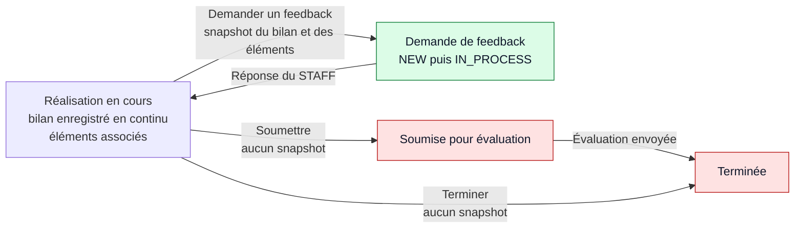
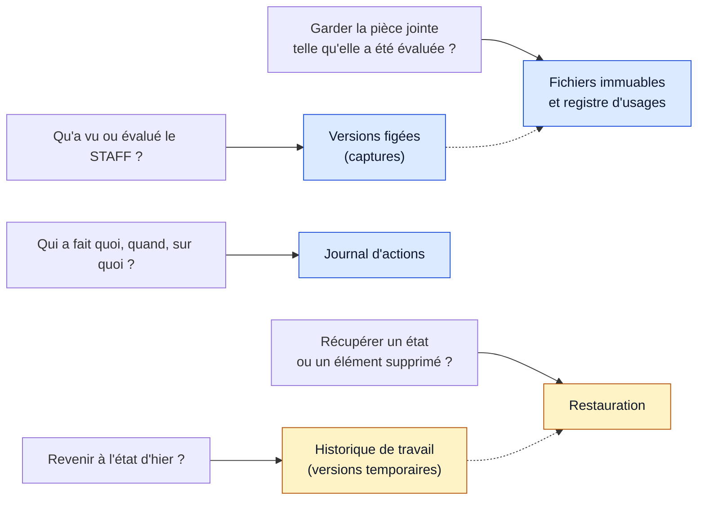
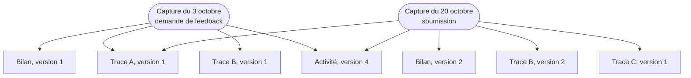
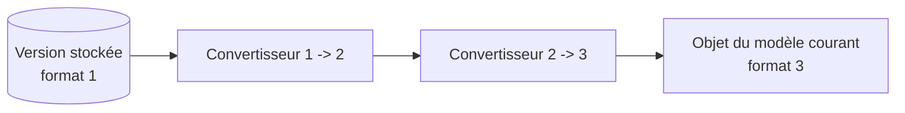
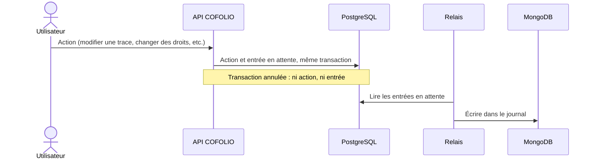
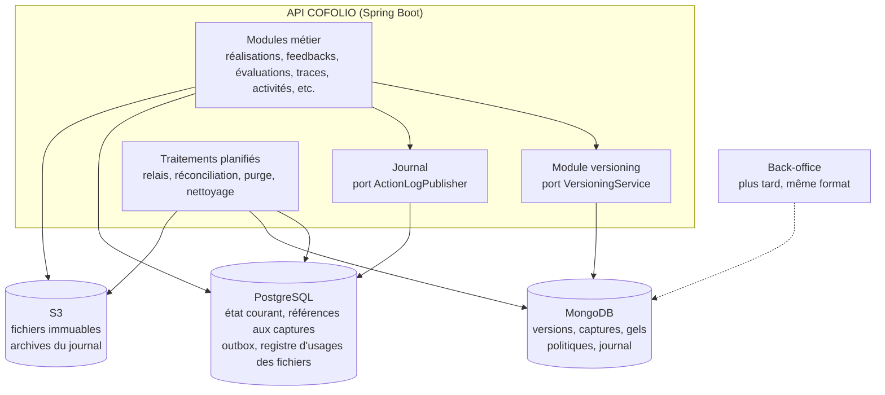
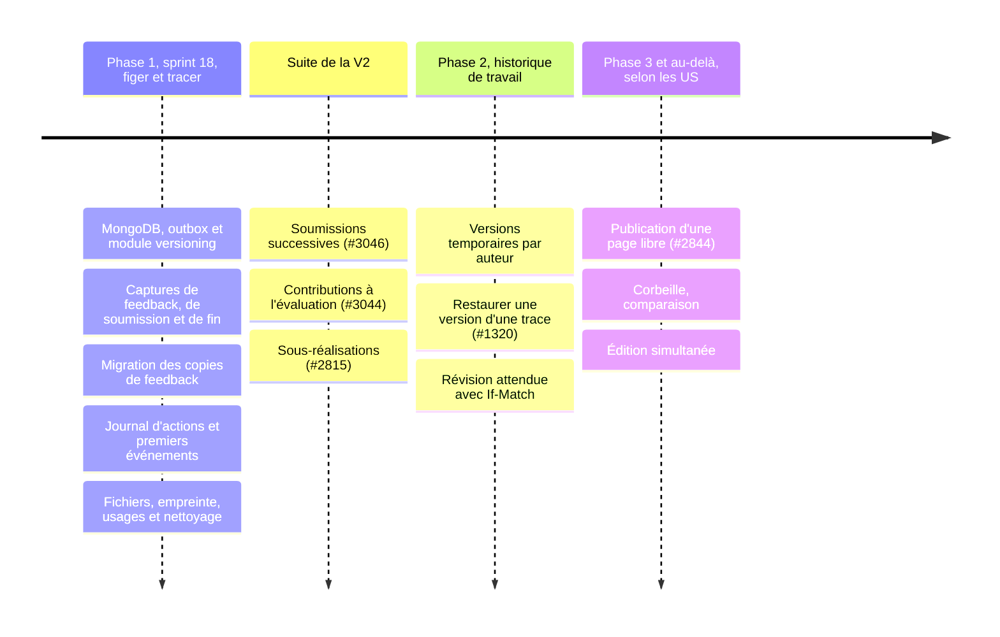

> **Statut :** proposition à débattre 
> **Date :** 9 novembre 2026 
> **US du sprint 18:** [#988], [#1191], [#2791], [#3018], [#3023], [#3163] 
> **US à venir :** [#1320], [#2815], [#2842], [#2844], [#2939], [#3044], [#3046] 
> **Développement technique :** [page dédiée](../rfc-versionnement-historisation-developpement)

<h3>Sommaire</h3>

* TOC
{:toc}

## En bref {#en-bref}

Aujourd'hui, COFOLIO écrase chaque modification. Trois besoins arrivent :
1. **Figer** ce qu'un apprenant transmet au STAFF : demande de feedback, soumission pour évaluation, fin de réalisation.
2. **Journaliser** les actions : qui a fait quoi, quand, sur quoi.
3. Plus tard, **garder un historique de travail** et pouvoir revenir à une version précédente.

Cette RFC propose un socle commun, construit en trois phases. Le [développement technique](../rfc-versionnement-historisation-developpement) détaille et justifie chaque proposition.

| Idée | En une phrase |
| --- | --- |
| **Capture** | Quand l'apprenant transmet, on enregistre une copie complète et immuable de sa réalisation (bilan, éléments associés) et de l'activité ; le STAFF lit cette copie, pas l'état courant. |
| **Gel** | Une capture est conservée tant que l'objet qui en a besoin existe : la demande de feedback, la soumission ou la réalisation. |
| **Lecture au format courant** | Une capture ancienne est convertie au moment où on la lit ; les données conservées ne sont jamais migrées. |
| **Fichiers** | Un fichier n'est supprimé que lorsque plus rien ne l'utilise, ni l'état courant ni une capture. |
| **Journal** | Une entrée par action effectivement enregistrée, sans contenu, écrite dans la même transaction que l'action. |
| **Stockage** | L'état courant reste dans PostgreSQL, sans changement ; captures et journal vont dans MongoDB dès la phase 1. |
| **Phases** | Phase 1 (sprint 18) : figer et tracer. Phase 2 : historique de travail et restauration. Phase 3 : selon les US. |

> **Ce qui est attendu :** challenger les hypothèses ([§2](#hypotheses)) et les décisions ([§4](#decisions)), répondre aux questions ouvertes ([§5](#questions)).

## 1. Contexte {#contexte}

### 1.1 L'existant {#existant}

#### Côté fonctionnel {#existant-fonctionnel}

Parcours d'une réalisation, tel qu'il fonctionne aujourd'hui :

_En vert : ce qui a été transmis est conservé. En rouge : rien n'est conservé, les écrans relisent l'état courant._

- **Bilan réflexif.** Saisi dans un éditeur WYSIWYG (Tiptap), enregistré automatiquement 5 secondes après la dernière frappe. Aucune version n'est gardée.
- **Demande de feedback ([#2641]).** L'apprenant transmet son bilan et ses éléments associés "au moment de l'envoi de la demande". Tant que le STAFF ne l'a pas ouverte (`NEW`), il peut la renvoyer : la copie est alors remplacée. Une fois la demande ouverte (`IN_PROCESS`), le renvoi est refusé. La réponse du STAFF reste modifiable jusqu'à ce que l'apprenant la consulte (`SEEN`).
- **Soumission pour évaluation ([#2531]).** Le bilan n'est plus modifiable, mais rien n'est copié : le STAFF évalue ce qu'il lit au moment où il ouvre la soumission.
- **Évaluation ([#2776], [#1311]).** Son envoi termine la réalisation. Son auteur peut la modifier ensuite, sans historique ([#1311], en recette) ; l'apprenant est notifié si la modification suit sa consultation.
- **Terminer.** L'apprenant peut terminer une réalisation sans évaluation ; rien n'est copié.
- **Ce que promet le front.** Quand l'apprenant modifie ou supprime une trace utilisée dans une activité soumise ou terminée, le front annonce que la modification ne s'appliquera pas à cette activité, ou que la trace "restera consultable depuis" l'activité. L'API ne tient cette promesse que pour les demandes de feedback.
- **Activité du STAFF.** Ses modifications sont notifiées aux apprenants inscrits, sauf celles du paramétrage d'évaluation, qui s'appliquent aussi aux soumissions déjà faites. Sa suppression définitive ([#1189]) supprime tout ce qui en dépend, fichiers compris.
- **Référentiel de compétences.** Synchronisé chaque nuit : les libellés sont écrasés, les compétences retirées sont archivées.
- **Désinscription.** Elle supprime les demandes de feedback en attente.
- **Un précédent de version publiée : les CGU.** Le back-office garde chaque version des CGU (fichier, numéro, date) et l'API enregistre la version acceptée par chaque utilisateur.
- **Données personnelles.** Il n'existe ni suppression de compte ni export des données d'un utilisateur.

#### Côté code {#existant-code}

Constats faits le _9 novembre 2026_ sur les différents services.

| # | Constat | Conséquence | Traitement proposé |
| :---: | --- | --- | --- |
| **C1** | À l'envoi d'une demande de feedback, le bilan est copié dans `feedback.reflection`, et les traces, compétences, expériences et formations associées dans `feedback.associations` (JSONB). | Copie incomplète : le libellé des compétences et les métadonnées des fichiers sont relus en direct. Copie écrasée à chaque renvoi tant que la demande est `NEW`. | Captures, puis migration des copies ([migration][d-migration]) |
| **C2** | La soumission ([#2531]) ne fige rien : `getAssessmentDetails` relit les associations en direct. Modifier ou supprimer une trace, associer ou dissocier un élément ne vérifie aucun verrou ; la liste des activités "verrouillées" sert seulement à afficher un avertissement. | Le STAFF peut évaluer un contenu modifié après la soumission, contrairement à ce qu'annonce le front. | Capture à la soumission ([déclencheurs][d-declencheurs]) |
| **C3** | L'évaluation est un `@Embeddable` unique sur `declared_activity`. | Incompatible avec plusieurs soumissions ([#3046]) et plusieurs contributions ([#3044]). | Identifiant de soumission dès [#988] ([soumission][d-soumission]) |
| **C4** | `ActivityServiceImpl.publish` réapplique le paramétrage d'évaluation même quand des apprenants sont inscrits, sans les notifier. | Une soumission peut être évaluée selon un paramétrage (commentaire, note, validation) différent de celui en vigueur au moment de la soumission. | Version de l'activité dans la capture ([périmètre][d-perimetre]) |
| **C5** | Les objets S3 ont une clé immuable (`{fileId}.{ext}`), jamais réécrite. Remplacer la pièce jointe d'une trace ne supprime pas l'ancien fichier. | Fichiers orphelins ; protection des pièces jointes copiées par une requête dédiée (`findAttachmentIdsUsedByTraceSnapshots`). | Registre d'usages et nettoyage ([fichiers][d-fichiers]) |
| **C6** | Deux tentatives ont été retirées : le versionnement des fichiers (`isActiveVersion` en mai 2026, colonne `version` en juillet 2026) et la suppression logique des traces (`deleted_at`, juin 2026 ; un `@SQLRestriction` sans effet est présent sur `TraceDatabaseRepository`). | Tout est supprimé physiquement. | Pas de suppression logique dans les tables métier ([corbeille][d-corbeille]) |
| **C7** | L'enregistrement automatique du bilan n'est pas forcé avant "Demander un feedback", "Soumettre" ou "Terminer". Aucune entité n'a de numéro de révision (`@Version`). La longueur du bilan est validée à 4 000 caractères à l'enregistrement, à 10 000 lors d'une demande de feedback. | Une capture peut manquer les dernières secondes de saisie ; deux onglets peuvent s'écraser sans le savoir. | Enregistrement forcé en phase 1, révision attendue en phase 2 ([cohérence][d-coherence]) |
| **C8** | Les institutions d'un utilisateur ne sont pas stockées par l'API : elles viennent du back-office (`/access`), via l'eppn. Une activité porte `targetInstitutionIds` ou `national`. Le contexte de requête (`RequestContext`, dans `avenirs-portfolio-common`) est un `ThreadLocal`. | Le journal doit enregistrer les institutions telles qu'elles sont au moment de l'action, et construire l'entrée avant tout passage en asynchrone. | [Format du journal][d-format-journal] |
| **C9** | Aucun journal d'actions ni événement applicatif n'existe ; l'audit JPA (`@EnableJpaAuditing`) ne renseigne que les dates de création et de modification. | - | [Journal d'actions][d-journal] |
| **C10** | 13 appels, répartis dans 6 services, suppriment directement des fichiers (`fileResourceService.delete`) : documents retirés d'une activité à sa publication, suppression définitive d'une activité, bannière ou document d'un brouillon, traces, pièces jointes de feedback, photos de profil et de couverture, connaissance de soi. | Un document retiré d'une activité disparaîtrait des captures qui le référencent. | Ces appels deviennent des retraits d'usage ; seul le nettoyage supprime ([nettoyage][d-nettoyage]) |
| **C11** | La synchronisation du référentiel de compétences (`SkillSyncServiceImpl`) écrase titre, code, description, parent et caractère évaluable, et archive les compétences retirées. | Une copie qui ne garde que l'identifiant de la compétence affiche un libellé qui a pu changer depuis. | Libellés copiés dans les versions ([périmètre][d-perimetre]) |
| **C12** | Les logs techniques (Logback) sont du texte, conservés 30 jours, sans identifiant de requête ; ils sont écrits même si la transaction est ensuite annulée. | Ils ne peuvent pas servir de journal : [#3018] ne veut que des actions effectivement enregistrées. | Journal dédié, identifiant de requête commun aux deux ([autres services et corrélation][d-services]) |
| **C13** | Le déploiement sans interruption (`docker-compose.zero-downtime.yml`) fait tourner une nouvelle instance de l'API à côté de l'ancienne le temps du déploiement ; le seul traitement planifié actuel de l'API (synchronisation du référentiel) n'a pas de verrou. | Deux instances peuvent exécuter le même traitement planifié en même temps ; tout nouveau traitement doit le supporter. | [Traitements planifiés][d-instances] |
| **C14** | Le back-office et l'interopérabilité ont leur propre base et partagent `avenirs-portfolio-common` avec l'API. | Un journal propre à l'API serait à refaire pour les actions d'administration du back-office. | Format et interface du journal dans `avenirs-portfolio-common` ([autres services et corrélation][d-services]) |

#### Limites face aux US du sprint 18 {#limites-sprint-18}

| US | Ce qu'elle demande | Ce qui manque aujourd'hui |
| :---: | --- | --- |
| **[#988]** | Une version de la réalisation créée à la soumission et conservée indépendamment des modifications ultérieures ; le STAFF évalue le contenu soumis, sans modification rétroactive ; l'évaluation est rattachée à cette version ; plusieurs versions possibles plus tard "sans nécessiter une refonte importante". | Rien n'est figé à la soumission (C2) ; évaluation unique (C3) ; paramétrage d'évaluation réappliqué (C4) ; fichiers supprimables (C10) ; dernière saisie parfois perdue (C7). |
| **[#3018]** | Un format commun pour les logs d'historique, créés seulement quand l'action a été réalisée et enregistrée. | Aucun journal (C9) ; les logs techniques ne conviennent pas (C12). |
| **[#1191]** | Journaliser les actions sur les traces, consultables par le SUPER ADMIN et des développeurs autorisés. | Journal absent ; institutions à récupérer au moment de l'action (C8). |
| **[#3023]** | Journaliser les changements de droits sur une activité, avec le membre du STAFF concerné. | Journal absent. |
| **[#2791]** | Tracer la suppression définitive d'une activité ([#1189]). | Journal absent ; une fois l'activité supprimée, son identifiant seul ne permet plus de la reconnaître. |
| **[#2641]** | Transmettre les éléments associés "au moment de l'envoi de la demande". | Copie incomplète (C1, C11), avec un mécanisme différent de celui qu'il faut pour [#988]. |

### 1.2 Besoins à venir {#besoins}

#### US des prochains sprints {#us-a-venir}

| US | Sujet | Besoin | Ce que le socle doit permettre | Phase |
| :---: | --- | --- | --- | --- |
| **[#3046]** | Réouvrir une réalisation terminée (V2) | "Chaque nouvelle soumission doit pouvoir être distinguée des soumissions précédentes conformément au socle de versionnage" ; contributions et évaluations restent liées à leur soumission. | Plusieurs captures par réalisation, chacune rattachée à sa soumission. | Mécanismes de la phase 1, plus une table des soumissions |
| **[#3044]** | Plusieurs évaluations internes (V2) | Plusieurs contributions du STAFF par soumission ; la saisie en cours est enregistrée automatiquement et retrouvée au retour. | Rattacher les contributions à une soumission. L'enregistrement automatique est un brouillon, pas un historique. | Mécanismes de la phase 1, plus le modèle métier |
| **[#2815]** | Sous-activités | Chaque sous-activité a ses propres associations. | Une capture arborescente. | Phase 1 (déjà prévu dans le manifeste) |
| **[#1311]** | Modifier une appréciation envoyée (V2, en recette) | Modifier sans créer de nouvelle version ni d'historique. | Rien : hors versionnement. | - |
| **[#3163]** | Consulter une évaluation | Préciser ce que signifie "consulter une évaluation". | Peut-être savoir quelle version d'une évaluation l'apprenant a vue. | À préciser |
| **[#1320]** | Restaurer une version d'une trace (V3, à rédiger) | Revenir à une version précédente d'une trace. | Un historique de travail des traces et la restauration. | Phase 2 |
| **[#2842]** | Co-construction d'une page libre | "Chaque modification enregistrée est associée à l'utilisateur qui l'a réalisée" ; plusieurs auteurs modifient la même ressource. | Des versions attribuées à un seul auteur, la détection des modifications concurrentes. | Phase 2 |
| **[#2844]** | Publication et dépublication d'une page libre | Si la page publiée reste consultable telle quelle pendant que ses auteurs la modifient : protéger la version publiée jusqu'à la dépublication. | Un gel `PUBLICATION`. | Phase 3 |
| **[#2939]** | Référentiels publiés par versions (V3) | Des versions numérotées et immuables ; les usages restent rattachés à leur version. | Rien de plus que d'enregistrer, dans les captures, la version du référentiel utilisée. | Hors socle |

#### Points relevés mais non formalisés {#points-releves}

- **"Gérer le bilan comme les traces".** Interprétée ici ainsi comme le bilan devient une ressource versionnée à part entière (HF3).
- **Le "freeze des logs".** Évoqué pendant les échanges, compris comme l'archivage en lecture seule des entrées anciennes du journal.
- **Regrouper les entrées de journal rapprochées.** Proposé pendant les échanges, écarté ici en raison d'une entrée par action ([détail][d-regroupement]).
- **Annuler (Ctrl-Z) après un rafraîchissement de la page.** À clarifier, car c'est l'historique de l'éditeur, pas le socle ; l'historique de travail de la phase 2 y répond autrement.
- **Ce que voit l'apprenant après coup.** Le front promet qu'une trace supprimée "restera consultable depuis" l'activité soumise ou terminée ; aucune US ne le formalise.
- **Durées de conservation.** Non fixées, ni pour ce qui est transmis, ni pour le journal.
- **Suppression de compte et export des données.** Aucune US, mais le socle doit les rendre possibles.

#### Limites et points à préciser {#a-preciser}

**Fonctionnels**, à trancher ([§5](#questions)) :
- Contenu d'une demande de feedback : l'état au dernier envoi (proposé) ou l'état au moment où le STAFF l'ouvre.
- Ce que l'apprenant voit d'une réalisation soumise ou terminée : ce qu'il a transmis, comme l'annonce le front, ou l'état courant.
- Périmètre de la restauration : [#1320] ne parle que des traces.
- Sens de "consulter une évaluation" ([#3163]).
- Durées de conservation et information des apprenants.

**Techniques**, pris en compte par la proposition :
- PostgreSQL et MongoDB n'ont pas de transaction commune.
- Plusieurs instances de l'API peuvent tourner en même temps (C13).
- Aucune ressource n'a de numéro de révision (C7).
- Le contexte de requête ne survit pas à un passage en asynchrone (C8).
- Le HTML des textes riches n'est nettoyé qu'à l'affichage, par le front.

### 1.3 But du document {#but}

- **Résoudre, pour le sprint 18, les limites listées plus haut :** figer à la soumission ([#988]), fiabiliser la copie des demandes de feedback, poser le journal commun ([#3018]) et ses premiers événements ([#1191], [#3023], [#2791]), ne plus perdre de fichiers utiles ni en laisser traîner d'inutiles.
- **Préparer les phases suivantes sans refonte :** soumissions successives, historique de travail, restauration, publication.
- **Servir de base de discussion :** chaque choix est à challenger, les alternatives sont exposées ([§3.7](#alternatives)) et les points ouverts listés ([§5](#questions)).
- **Ce que le document ne fait pas :** il ne fixe pas les durées de conservation, ne définit aucun écran et ne remplace pas les US.

## 2. Hypothèses {#hypotheses}

### 2.1 Hypothèses fonctionnelles {#hypotheses-fonctionnelles}

| # | Hypothèse | Pourquoi | Si elle ne tient pas |
| :---: | --- | --- | --- |
| **HF1** | Ce qui a été transmis (demande de feedback, soumission, fin de réalisation) reste consultable tel quel, tant que l'objet qui l'a transmis existe. | [#988], [#2641] et [#985] le demandent pour le feedback et la soumission ; le front le promet déjà pour les activités soumises ou terminées. | Sans la fin de réalisation, on retire un déclencheur ; rien d'autre ne change. |
| **HF2** | Une demande de feedback contient l'état au dernier envoi. | C'est le comportement actuel, conforme à [#2641], et [#988] demande de ne pas modifier le parcours fonctionnel. | S'il est décidé de conserver l'état au moment où le STAFF ouvre la demande, la capture passe de l'envoi à l'ouverture, sans changer le modèle. |
| **HF3** | Le bilan est géré "comme les traces" : une ressource versionnée à part entière, qui reste attachée à sa réalisation. | Il aura son propre historique et sa propre restauration en phase 2, comme une trace ([#1320]). | S'il doit rejoindre la bibliothèque de traces, c'est un changement du modèle métier ; le versionnement ne change pas. |
| **HF4** | En phase 1, personne ne consulte d'historique : on fige et on trace, sans écran d'historique ni comparaison. | Aucune US ne le demande avant [#1320] (V3). | Les données existent déjà ; il manque l'écran et la route de consultation. |
| **HF5** | Une seule soumission par réalisation en phase 1, plusieurs ensuite. | [#988] exclut les soumissions successives, [#3046] les apporte. | Le modèle accepte déjà plusieurs captures par réalisation ; il manque la table des soumissions. |
| **HF6** | Le journal sert à l'administration technique et à la traçabilité. Il est lu par le SUPER ADMIN et des développeurs autorisés, pas par les apprenants, et ne sert pas au reporting. | [#1191], critère 3 ; le reporting est une autre finalité au sens du RGPD. | Un écran pour les établissements reste possible, puisque les entrées portent les institutions ; il faudra en définir les droits. |
| **HF7** | Un enregistrement automatique n'est pas une action à journaliser. | Une entrée toutes les 5 secondes n'apprend rien ; [#3018] ne crée un log que lorsque l'action "a effectivement été réalisée et enregistrée" ; minimisation des données. | Si une US l'exige, l'événement sera placé à une étape significative (envoi, nouvelle version), jamais à chaque enregistrement. |
| **HF8** | Les durées de conservation devront être définies et ajustées. | Elles découlent des finalités, pas de la technique. | Les valeurs proposées sont des paramètres ; seule la politique change. |
| **HF9** | L'historique de travail sert à revenir quelques heures ou quelques semaines en arrière, pas à archiver. | Pratique courante : Google Drive ne garde en général les anciennes révisions d'un fichier que 30 jours ou dans la limite de 100. Le volume reste maîtrisé. | Un besoin de conservation longue relève d'un gel, pas de l'historique de travail. |
| **HF10** | Restaurer ne réécrit jamais l'historique : on crée un nouvel état courant à partir d'une ancienne version. | On peut toujours revenir sur une restauration ; rien n'est perdu. | Une restauration qui supprimerait les versions postérieures serait irréversible. |

### 2.2 Hypothèses techniques {#hypotheses-techniques}

| # | Hypothèse | Pourquoi | Si elle ne tient pas |
| :---: | --- | --- | --- |
| **HT1** | L'état courant ne change pas : mêmes tables PostgreSQL, mêmes lectures et écritures. Le versionnement s'ajoute à côté. | Le code est en production ; versionner ne doit pas obliger à réécrire chaque module. | Une refonte (*event sourcing*, par exemple) serait hors de proportion ([§3.7](#alternatives)). |
| **HT2** | Une version est un état complet, pas une différence (principe "Tout ou rien"). | Lecture directe, sans rejouer de modifications ; purger revient à supprimer ; quelques Ko par version. Git procède ainsi : ses commits sont des instantanés, les différences sont calculées à la demande. | Si les volumes explosent : compression ou différences internes au stockage, invisibles pour l'API. |
| **HT3** | Lire plutôt que migrer : le système retourne toujours un objet valide au format attendu, quelle que soit l'ancienneté de la version ; les données conservées ne sont jamais réécrites. | Une version figée sert de preuve : la réécrire changerait son empreinte. Migrer du JSON en masse à chaque évolution du modèle est long, risqué et à refaire à chaque fois. MongoDB documente ce patron (*Schema Versioning*), les systèmes à base d'événements aussi (*upcasting*). | Si un convertisseur devient trop lourd, une migration explicite et journalisée reste possible, à titre exceptionnel. |
| **HT4** | Versions, captures et journal sont stockés dans MongoDB dès la phase 1. | Décision à prendre : ne pas migrer de stockage le jour où l'historique de travail fera croître les volumes. | Tout dans PostgreSQL : le socle reste le même et plusieurs mécanismes disparaissent ([§3.7](#alternatives)). |
| **HT5** | Les fichiers S3 sont immuables : chaque dépôt crée un objet, jamais réécrit. | Constat C5 : il suffit de les référencer, sans les copier. | Si un fichier pouvait être réécrit, il faudrait copier l'objet à chaque gel. |
| **HT6** | Plusieurs instances de l'API peuvent tourner en même temps (mécanisme utilisé actuellement pour réduire le downtime de la plateforme dev, mais courant en auto scalling). | Déploiement sans interruption (C13) ; une montée en charge le demanderait aussi. | Hypothèse prudente : elle ne coûte rien si elle est fausse. |
| **HT7** | Le texte riche est le HTML produit par l'éditeur WYSIWYG (Tiptap), stocké tel quel et nettoyé à l'affichage. | C'est le fonctionnement actuel ; la documentation de Tiptap juge HTML et JSON aussi adaptés l'un que l'autre au stockage. | Passer au format JSON de l'éditeur créerait un nouveau format de version, géré comme tout changement de format (HT3). |
| **HT8** | Quelques millions de captures par an au plus, de quelques Ko chacune. | Ordre de grandeur pour 100 000 apprenants actifs, à remplacer par des mesures. | Index et archivage seraient à revoir, pas le modèle. |

## 3. Vue d'ensemble des approches {#approches}

### 3.1 Cinq mécanismes à ne pas mélanger {#tri}

Les mots *version*, *historique* et *snapshot* ont recouvert des idées différentes. Elles répondent en réalité à cinq questions distinctes, qui n'ont ni la même nature ni la même durée de vie.

_En bleu : phase 1. En jaune : phase 2. Restaurer un élément supprimé attend une US._

| Mécanisme | Répond à | US | Nature | Phase |
| --- | --- | --- | --- | --- |
| **Versions figées** (captures) | Qu'a vu ou évalué le STAFF ? | [#988], [#985], [#2641], [#3046] | État complet et immuable, protégé tant qu'un objet métier en a besoin | 1 |
| **Journal d'actions** | Qui a fait quoi, quand, sur quoi ? | [#3018], [#1191], [#3023], [#2791] | Métadonnées sans contenu, écrites une fois, jamais restaurées | 1 |
| **Fichiers** | Garder la pièce jointe telle qu'elle a été évaluée | transverse | Objets immuables, référencés, supprimés quand plus rien ne les utilise | 1 |
| **Historique de travail** | Revenir à l'état d'hier | [#1320], [#2842] | Versions temporaires, éclaircies puis purgées | 2 |
| **Restauration** | Récupérer un état ou un élément supprimé | [#1320] | Nouvel état courant créé à partir d'une version | 2 ; élément supprimé : selon les US |

> **À ne pas confondre**
> - **Annuler et rétablir dans l'éditeur** (Ctrl-Z) : historique propre à l'éditeur, en mémoire dans le navigateur.
> - **Édition collaborative** : synchronisation en temps réel entre plusieurs personnes, autre système.
> - **Logs techniques** (Logback) : diagnostic de l'application, sans valeur de traçabilité métier ; ils relèvent du [Monitoring](../arch-soft-specif-monitoring).
> - **Notifications** : elles informent un utilisateur ("évaluation modifiée") ; elles ne prouvent rien et ne remplacent ni le journal ni les captures.
> - **Reporting et statistiques** : autre finalité au sens du RGPD, à ne pas construire sur le journal d'actions.

### 3.2 Vocabulaire {#vocabulaire}

| Terme | Définition |
| --- | --- |
| **Version** | Copie complète et immuable d'un élément (bilan, trace, compétence déclarée, activité, etc.) à un instant donné. |
| **Capture** | Version d'une réalisation entière, prise lors d'une action métier : un **manifeste** qui pointe vers une version de chacun de ses éléments. |
| **Gel** | Lien entre une capture et l'objet métier qui en a besoin, son **détenteur** (demande de feedback, soumission, réalisation, etc.). Tant qu'un gel est en vigueur, la capture ne peut pas être purgée. |
| **Version figée** | Version protégée par au moins un gel, directement ou via une capture. Ce statut se calcule à partir des gels ; il n'est pas stocké. |
| **Politique de conservation** | Règle, identifiée par un code et une révision, qui fixe l'**échéance** d'un gel une fois son détenteur supprimé. Après l'échéance, la capture peut être purgée. |
| **Bail** | Courte réservation posée sur une version réutilisée par une capture en cours d'écriture, pour qu'une purge concurrente ne la supprime pas. |
| **Mise à niveau à la lecture** | Conversion d'une version stockée dans un ancien format vers le format courant, au moment où on la lit (*upcasting*). |
| **Journal d'actions** | Enregistrement des actions effectivement réalisées, au format commun de [#3018], sans contenu. |
| **Outbox** | Table PostgreSQL où l'API inscrit, dans la transaction métier, ce qui doit être fait après le commit ; un relais l'exécute ensuite. |
| **Version temporaire** (phase 2) | Version sans gel, créée pendant le travail, éclaircie avec le temps puis purgée. |
| **Révision** (phase 2) | Numéro de l'état courant d'un élément, augmenté à chaque modification ; il sert à détecter les modifications concurrentes. |

### 3.3 Phase 1 : figer et tracer {#phase-1}

- **Ce que la phase 1 ne fait pas :** Pas d'écran d'historique, pas de comparaison, pas de restauration, pas de version temporaire, pas d'accès des apprenants au journal.
- **Ce que la phase 1 prépare pour la suite de la V2 :** Un identifiant de soumission est créé dès [#988]. La future table des soumissions ([#3046], [#3044]) reprendra ces identifiants sans rien changer côté MongoDB. Le manifeste a déjà une place pour les sous-réalisations ([#2815]).

#### 3.3.1 Figer (la capture) {#phase-1-capture}

Quand l'apprenant demande un feedback, soumet ou termine, COFOLIO enregistre une capture : sa réalisation, son bilan, ses éléments associés et l'activité, tels qu'ils sont à cet instant. Les interfaces STAFF lisent la capture au lieu de l'état courant ; ils ne changent pas, seule la source des données change.

> **Exemple.** Léa demande un feedback le 3 octobre : la capture contient son bilan, les traces A et B et l'activité. Le 10, elle modifie la trace B et ajoute la trace C. Le 20, elle soumet : nouvelle capture. Seuls le bilan, la trace B modifiée et la nouvelle trace C créent des versions ; la trace A et l'activité, inchangées, réutilisent celles du 3 octobre. Le 21, Léa supprime la trace B de sa bibliothèque : le STAFF qui évalue la voit toujours, telle qu'elle a été soumise.

_Une version est réutilisée tant que l'élément n'a pas changé : chaque capture est complète, sans rien dupliquer._

Chaque version se suffit : elle copie les libellés et les métadonnées de fichier nécessaires à l'affichage, pour ne dépendre ni du référentiel de compétences (C11), ni de la table des fichiers. La version de l'activité, partagée par tous les apprenants tant que l'activité ne change pas, fixe le paramétrage d'évaluation en vigueur à la soumission (C4).

> **Pratique de référence.** C'est le fonctionnement d'un commit Git : il pointe vers une arborescence d'objets identifiés par l'empreinte de leur contenu, si bien qu'un fichier inchangé n'est jamais recopié d'un commit à l'autre ([détail][d-capture]).

#### 3.3.2 Combien de temps (le gel) {#phase-1-gel}

Chaque capture reçoit un gel au nom de son détenteur. Tant que la demande de feedback, la soumission ou la réalisation existe, la capture ne peut pas être purgée ; quand le détenteur est supprimé, le gel prend fin et la capture devient purgeable. Une capture peut avoir plusieurs gels ; elle n'est purgeable que lorsqu'ils ont tous pris fin.

> **Exemple.** Une désinscription supprime les demandes de feedback en attente : leurs captures deviennent purgeables. Celle de la soumission, elle, reste tant que la soumission existe.
> 
> **Pratique de référence.** Une conservation qui commence à un événement (ici, la suppression du détenteur) est la rétention déclenchée par un événement des outils de gestion documentaire ; des protections cumulables qui doivent toutes être levées avant suppression sont l'équivalent de leurs *holds*. La conservation dure ainsi exactement le temps où quelqu'un a besoin du contenu, sans durée arbitraire ([détail][d-gels]).

#### 3.3.3 Lire au format actuel {#phase-1-format}

Une version garde le format dans lequel elle a été écrite. Au moment de la lire, une chaîne de convertisseurs l'amène au format courant : le code métier ne voit jamais d'ancien format, et on ne migre jamais les données conservées (HT3).

> **Exemple.** Si, en 2027, le champ `personalNote` d'une trace est renommé, une capture de 2026 est convertie à la lecture : l'écran reçoit une trace au format 2027, et la capture stockée n'a pas changé.

> **Pratique de référence.** C'est le patron *Schema Versioning* documenté par MongoDB (chaque document porte la version de son schéma) et l'*upcasting* des systèmes à base d'événements, qui convertissent les anciens événements à la lecture au lieu de les réécrire ([détail][d-format]).

#### 3.3.4 Les fichiers {#phase-1-fichiers}

Les fichiers S3 ne sont jamais réécrits (HT5) : une version référence le fichier exact, sans le copier. Un traitement de nettoyage devient le seul à supprimer des fichiers, et seulement quand plus rien ne les utilise, ni l'état courant ni une version. Les suppressions directes actuelles (C10) deviennent des retraits d'usage ([détail][d-fichiers]).

#### 3.3.5 Le journal {#phase-1-journal}

Une entrée par action effectivement enregistrée : qui (l'acteur et, s'il diffère, l'utilisateur concerné), quoi (ajout, modification, suppression), quand (à la milliseconde), sur quoi (l'objet et son contexte : activité, institutions, etc.). Jamais de contenu, et rien pour un enregistrement automatique. Les événements sont nommés `OBJET_VERBE` (`TRACE_UPDATED`), comme le recommande le vocabulaire de journalisation de l'OWASP.

> **Exemple.** "Le 9 novembre à 14 h 02, Paul (STAFF) a ajouté le droit EVALUATION à Marie sur l'activité X, ciblée sur l'établissement Y." L'entrée contient les identifiants de Paul, de Marie, de l'activité et de l'établissement, et les droits avant et après ; pas le titre de l'activité.

L'entrée est inscrite dans la même transaction que l'action, dans une table d'attente (outbox) ; un relais la copie ensuite dans MongoDB. Si l'action échoue, l'entrée disparaît avec elle ; si MongoDB est indisponible, elle attend. C'est le patron *transactional outbox*.

Les entrées restent consultables 3 mois dans MongoDB, puis sont archivées en lecture seule dans S3 jusqu'à 12 mois, durée à valider (la CNIL recommande de 6 mois à 1 an). Un identifiant de requête, présent à la fois dans le journal et dans les logs techniques, permet de passer de l'un à l'autre.

#### 3.3.6 Où sont les données {#phase-1-donnees}

L'état courant reste dans PostgreSQL, sans changement (HT1), avec les références vers les captures. Versions, captures, gels et journal sont dans MongoDB ; les fichiers et les archives du journal dans S3.

### 3.4 Phase 2 : historique de travail et restauration {#phase-2}

La phase 2 est une **évolution, pas une refonte** : elle ajoute des versions là où la phase 1 n'en crée que lors d'un gel, et réutilise tout le reste.

- **Versions temporaires.** Pour le bilan, enregistré en continu, on crée au plus une version par quart d'heure, et seulement si le contenu a changé. Pour une trace, enregistrée par un formulaire ([#1320]), chaque enregistrement qui change son contenu crée une version. Une version n'a qu'un auteur, ce qui permet d'attribuer chaque modification à son auteur ([#2842]).
- **Éclaircissement.** Avec le temps, on ne garde qu'une version par heure, puis par jour, puis par semaine ; au-delà de 90 jours, les versions temporaires sont purgées, sauf celles qu'une capture a figées. Les outils de sauvegarde procèdent ainsi (rotation des sauvegardes, `restic forget`).
- **Restauration.** Restaurer une version crée un nouvel état courant à partir d'elle ; l'état remplacé est d'abord gardé comme version. On peut donc toujours revenir en arrière, y compris sur une restauration.
- **Modifications concurrentes.** Chaque élément édité reçoit un numéro de révision. Le front envoie la révision qu'il a modifiée (en-tête HTTP standard `If-Match`) ; si quelqu'un a modifié l'élément entre-temps, l'API refuse avec la réponse 412 (RFC 9110) au lieu d'écraser le travail de l'autre.

> **Exemple.** Léa travaille son bilan pendant une heure : l'enregistrement automatique écrit l'état courant des dizaines de fois, mais seules 4 versions temporaires sont créées. Dix jours plus tard, il en reste une ; après 90 jours, aucune, sauf si une capture l'a figée entre-temps. Un lundi, elle restaure la version du vendredi précédent : son texte du lundi devient une version, celui du vendredi redevient l'état courant.

| Brique | Phase 1 | Ce que la phase 2 ajoute |
| --- | --- | --- |
| **Collection des versions** | Versions créées lors d'une capture | Versions temporaires, sans gel |
| **Gels et purge** | Purge des captures et des versions qui ne sont plus référencées | Éclaircissement des versions temporaires |
| **Formats et convertisseurs** | Toutes les versions | Inchangés |
| **Fichiers** | Référencés par les versions, nettoyés quand plus rien ne les utilise | L'ancien fichier d'une pièce jointe remplacée reste une version temporaire |
| **Journal** | Actions des US, événements du versionnement | `VERSION_RESTORED` |
| **Tables métier** | Inchangées, plus quelques références vers les captures | Une colonne de révision sur les éléments édités |
| **API** | Routes existantes, lues depuis les captures | En-tête `If-Match` ; routes d'historique et de restauration |

### 3.5 Phase 3 et au-delà {#phase-3}

Chaque besoin connu se traite avec les mêmes briques :

- **Publication d'une page libre ([#2844]).** Si la version publiée doit rester consultable pendant que les auteurs modifient la page, un gel `PUBLICATION` la protège jusqu'à la dépublication : un nouveau détenteur, une nouvelle politique, le même mécanisme.
- **Référentiels publiés par versions ([#2939]).** Des versions numérotées et consultées en permanence relèvent du modèle métier, comme les CGU aujourd'hui. Les captures enregistrent seulement la version du référentiel utilisée.
- **Corbeille.** Garder la dernière version d'un élément supprimé pendant quelques jours : une politique de plus, sans suppression logique dans les tables métier (C6).
- **Restaurer une réalisation entière** depuis une capture : en cascade, sans écraser ce qui existe encore.
- **Comparer deux versions** : calculé à la lecture à partir de versions complètes, sans rien stocker de plus.
- **Édition simultanée** : un document partagé synchronisé en temps réel (par exemple avec Yjs, sur lequel repose l'extension de collaboration de Tiptap) ; le socle versionne ce document à intervalles réguliers et lors des gels.
- **Consultation d'une évaluation ([#3163]).** Les dates d'envoi, de modification et de consultation disent déjà si l'apprenant a vu la dernière version. Savoir quelle version il a vue demanderait de versionner l'évaluation, ce que [#1311] exclut aujourd'hui.

### 3.6 Architecture et calendrier {#architecture}

- Le versionnement et le journal sont des **modules de l'API**, déployés avec elle. Les modules métier n'y accèdent que par deux ports : `VersioningService` (créer, lire et protéger des captures) et `ActionLogPublisher` (publier une entrée du journal).
- Seuls ces modules connaissent MongoDB : ils pourront devenir un service séparé, s'il le faut un jour, sans toucher aux modules métier.
- Le format du journal et l'interface de publication sont placés dans `avenirs-portfolio-common`, déjà partagé (C14) : ces services pourront journaliser leurs actions d'administration dans le même format, le jour où une US le demandera.

### 3.7 Alternatives et pièges {#alternatives}

Voici les alternatives sérieuses, ce qu'elles simplifient, et pourquoi elles ne suffisent pas.

| Alternative | Ce qu'elle simplifie | Pourquoi elle ne suffit pas | Quand la reconsidérer |
| --- | --- | --- | --- |
| Étendre la copie JSON des feedbacks à la soumission et à la fin de réalisation | Une colonne JSONB par usage, aucune brique nouvelle | Copie incomplète (libellés écrasés chaque nuit, fichiers supprimables) ; règles de conservation et de suppression à réinventer à chaque usage ; lecture cassée dès que le modèle Java change | Si l'on renonce à tout historique au-delà de [#988] |
| Hibernate Envers (audit des entités JPA) | Historique automatique de chaque entité, dans PostgreSQL, interrogeable à une révision donnée | Enregistre chaque transaction, donc chaque enregistrement automatique du bilan ; aucune notion de gel ni de conservation par motif ; chaque évolution du modèle doit être appliquée aux tables d'audit, donc à tout l'historique ; ne couvre pas les fichiers | Pour l'historique de travail d'entités simples, si MongoDB est abandonné |
| Tout dans PostgreSQL (JSONB) | Une seule transaction : plus de gel en attente, de réconciliation ni de bail | Migration de stockage à prévoir si les volumes croissent ; grosses tables dans la base principale | Si MongoDB n'est pas déployable, ou si son coût d'exploitation est jugé trop élevé |
| Versioning natif de S3 | Rien à coder pour les fichiers | Une seule protection binaire par version ; cycle de vie aveugle aux besoins métier ; effacement RGPD plus compliqué ; ne couvre pas le reste | En filet de sécurité d'infrastructure, en complément |
| *Event sourcing* | Historique complet par construction | Réécrire la persistance de tous les modules | Hors de proportion pour ce besoin |
| Logback ou OpenSearch comme journal | Déjà en place, ou outil de recherche | Logback écrit même quand la transaction est annulée, en texte, pour 30 jours. | OpenSearch pour un futur outil de consultation alimenté par le journal |
| Écouteur Spring après commit (`@TransactionalEventListener`) au lieu de l'outbox | Ni table ni relais | L'entrée n'existe qu'en mémoire : si MongoDB est indisponible, ou si l'instance s'arrête entre le commit et l'envoi, elle est perdue et rien ne la rejoue | Si l'on accepte de perdre des entrées |

Une part de la complexité vient du choix de MongoDB, pas du versionnement lui-même (complexité assumée) :
| Élément | Avec MongoDB (proposé) | Tout dans PostgreSQL |
| --- | --- | --- |
| Captures, versions, empreintes, mise à niveau à la lecture | oui | oui |
| Gels avec détenteur et politiques de conservation | oui | oui ; le détenteur peut devenir une clé étrangère |
| Registre d'usages, nettoyage des fichiers, suppression S3 via l'outbox | oui | oui |
| Outbox pour le journal | oui | non : insertion dans la transaction métier |
| Gel en attente (`PENDING`) et réconciliation | oui | non |
| Bail sur les versions réutilisées | oui | non : verrou de ligne |
| Une base de plus à exploiter (replica set, sauvegardes, supervision, compétences) | oui | non |
| Migration de stockage le jour où les volumes croissent | non | à prévoir |

Les lignes 4 à 7 sont le prix de la décision D1 : il faut le mettre en balance avec la migration qu'elle évite. Le reste est nécessaire quel que soit le stockage.

## 4. Décisions proposées {#decisions}

| # | Décision | Alternative écartée | À challenger | Détail |
| :---: | --- | --- | --- | --- |
| **D1** | MongoDB dès la phase 1 pour les versions, les captures, les gels et le journal | Tout dans PostgreSQL | Déploiement, coût d'exploitation ([§3.7](#alternatives)), etc. | [ADR][d-adr-mongodb] |
| **D2** | Capture = manifeste de versions complètes qui se suffisent (principe WYSIWYG) | Copie monolithique refaite à chaque fois ; audit des entités (Envers) | - | [Capture et manifeste][d-capture] |
| **D3** | Gel lié à son détenteur, échéance à sa suppression | Durée fixe comptée depuis l'action | Plafond éventuel imposé | [Gels][d-gels] |
| **D4** | Captures à la demande de feedback, à la soumission et à la fin de réalisation | Ne rien figer à la fin de réalisation | Utilité de la capture de fin (HF1) | [Déclencheurs][d-declencheurs], réouverture d'une activité |
| **D5** | Une demande de feedback contient l'état au dernier envoi | État à l'ouverture par le STAFF | Arbitrage PO | [Déclencheurs][d-declencheurs] |
| **D6** | Identifiant de soumission dès [#988], table des soumissions avec [#3044] et [#3046] | Table dès maintenant | - | [Soumission][d-soumission] |
| **D7** | Mise à niveau à la lecture ; versions figées jamais réécrites | Migration en masse | - | [Format][d-format] |
| **D8** | Bilan = ressource versionnée à part entière | Bilan intégré à la bibliothèque de traces | Interprétation de "comme les traces" | [Périmètre][d-perimetre] |
| **D9** | Fichiers immuables, registre d'usages et nettoyage ; versioning S3 en filet de sécurité | Versioning S3 comme mécanisme métier | Registre ou requête par module | [Fichiers][d-fichiers] |
| **D10** | Journal : outbox puis MongoDB, sans contenu, une entrée par action, regroupement seulement à l'affichage | Logback ou OpenSearch ; écouteur après commit ; fusion des entrées à l'écriture | Durée de conservation ; archivage dès la phase 1 ou plus tard | [Journal][d-journal] |
| **D11** | Format du journal et interface de publication dans `avenirs-portfolio-common` ; identifiant de requête commun au journal et aux logs techniques | Journal propre à l'API | - | [Autres services et corrélation][d-services] |
| **D12** | Pas de versions temporaires en phase 1 | Historique de travail dès le sprint 18 | - | [Phase 2][d-phase-2] |
| **D13** | En phase 2, une version temporaire n'a qu'un auteur ; au plus une par quart d'heure en enregistrement continu, une par enregistrement explicite sinon | Versions mêlant plusieurs auteurs ; une version par enregistrement automatique | Nombre de versions en co-construction | [Versions temporaires][d-versions-temporaires] |
| **D14** | Restaurer crée un nouvel état courant ; l'historique n'est jamais réécrit | Restauration qui supprime les versions postérieures | - | [Restauration][d-restauration] |

## 5. Questions ouvertes {#questions}

**Pour le métier/PO**

1. Une demande de feedback contient-elle l'état au dernier envoi (proposé) ou l'état au moment où le STAFF l'ouvre ?
2. Pour une réalisation soumise ou terminée, l'apprenant voit-il ce qu'il a transmis (la capture), comme l'annonce le front, ou l'état courant ?
3. [#1320] ne concerne que les traces : faut-il aussi restaurer le bilan, les compétences déclarées, les pages libres ? Qui peut restaurer ?
4. Que signifie "consulter une évaluation" ([#3163]) ? Faut-il savoir quelle version de l'évaluation l'apprenant a vue ?
5. L'interprétation de "gérer le bilan comme les traces" (HF3) est-elle la bonne ?
6. Combien de temps conserver les données du portfolio, donc les captures, après la fin du cursus ou la suppression du compte ? Faut-il un plafond ?
7. Existe-t-il une obligation de conserver les évaluations et ce qui a été évalué ?
8. Quelle durée de conservation pour le journal (12 mois proposés), éventuellement par type d'événement ?
9. Comment informer les apprenants que ce qu'ils transmettent est conservé, même s'ils le suppriment ensuite ?
10. Quand faudra-t-il permettre la suppression d'un compte et l'export des données d'un utilisateur ?

**Pour l'équipe**

{:start="11"}
11. MongoDB : offre disponible, replica set, sauvegardes, supervision, chiffrement, etc. ; licence SSPL.
12. S3 : versioning, Object Lock et règles de cycle de vie sont-ils disponibles, pour le filet de sécurité et les archives du journal ?
13. Volumétrie réelle/estimée : apprenants actifs, réalisations, demandes de feedback et soumissions par an.
14. Registre d'usages des fichiers, ou requête par module ?
15. Découpage en US techniques et ordre de priorité.

## Références {#references}

Les références complètes, et la façon dont chaque proposition se rattache à une pratique établie, sont dans l'[annexe du développement][d-pratiques]. Les principales :
- [CNIL : Recommandation relative aux mesures de journalisation](https://cnil.fr/fr/la-cnil-publie-une-recommandation-relative-aux-mesures-de-journalisation){:target="_blank"}
- [RGPD](https://eur-lex.europa.eu/eli/reg/2016/679/oj){:target="_blank"}
- [OWASP : Logging Vocabulary Cheat Sheet](https://cheatsheetseries.owasp.org/cheatsheets/Logging_Vocabulary_Cheat_Sheet.html){:target="_blank"}
- [microservices.io : Transactional outbox](https://microservices.io/patterns/data/transactional-outbox.html){:target="_blank"}
- [MongoDB : Schema Versioning](https://www.mongodb.com/docs/manual/data-modeling/design-patterns/data-versioning/schema-versioning){:target="_blank"}
- [GitHub : Commits are snapshots, not diffs](https://github.blog/open-source/git/commits-are-snapshots-not-diffs/){:target="_blank"}
- [Microsoft Purview : Rétention déclenchée par un événement](https://learn.microsoft.com/en-us/purview/event-driven-retention){:target="_blank"}
- [Google Drive : Gestion des révisions](https://developers.google.com/drive/api/guides/manage-revisions?hl=fr){:target="_blank"}
- [Tiptap : Output JSON and HTML](https://tiptap.dev/docs/guides/output-json-html){:target="_blank"}
- [Hibernate Envers](https://hibernate.org/orm/envers/){:target="_blank"}
- [Martin Fowler : Event Sourcing](https://martinfowler.com/eaaDev/EventSourcing.html){:target="_blank"}

[#985]: https://github.com/avenirs-esr/AVENIRS-Project/issues/985
[#988]: https://github.com/avenirs-esr/AVENIRS-Project/issues/988
[#1189]: https://github.com/avenirs-esr/AVENIRS-Project/issues/1189
[#1191]: https://github.com/avenirs-esr/AVENIRS-Project/issues/1191
[#1311]: https://github.com/avenirs-esr/AVENIRS-Project/issues/1311
[#1320]: https://github.com/avenirs-esr/AVENIRS-Project/issues/1320
[#2531]: https://github.com/avenirs-esr/AVENIRS-Project/issues/2531
[#2641]: https://github.com/avenirs-esr/AVENIRS-Project/issues/2641
[#2776]: https://github.com/avenirs-esr/AVENIRS-Project/issues/2776
[#2791]: https://github.com/avenirs-esr/AVENIRS-Project/issues/2791
[#2815]: https://github.com/avenirs-esr/AVENIRS-Project/issues/2815
[#2842]: https://github.com/avenirs-esr/AVENIRS-Project/issues/2842
[#2844]: https://github.com/avenirs-esr/AVENIRS-Project/issues/2844
[#2939]: https://github.com/avenirs-esr/AVENIRS-Project/issues/2939
[#3018]: https://github.com/avenirs-esr/AVENIRS-Project/issues/3018
[#3023]: https://github.com/avenirs-esr/AVENIRS-Project/issues/3023
[#3044]: https://github.com/avenirs-esr/AVENIRS-Project/issues/3044
[#3046]: https://github.com/avenirs-esr/AVENIRS-Project/issues/3046
[#3163]: https://github.com/avenirs-esr/AVENIRS-Project/issues/3163

[d-perimetre]: ../rfc-versionnement-historisation-developpement#perimetre
[d-capture]: ../rfc-versionnement-historisation-developpement#capture
[d-gels]: ../rfc-versionnement-historisation-developpement#gels
[d-declencheurs]: ../rfc-versionnement-historisation-developpement#declencheurs
[d-soumission]: ../rfc-versionnement-historisation-developpement#soumission
[d-coherence]: ../rfc-versionnement-historisation-developpement#coherence
[d-format]: ../rfc-versionnement-historisation-developpement#format
[d-adr-mongodb]: ../rfc-versionnement-historisation-developpement#adr-mongodb
[d-fichiers]: ../rfc-versionnement-historisation-developpement#fichiers
[d-nettoyage]: ../rfc-versionnement-historisation-developpement#nettoyage
[d-journal]: ../rfc-versionnement-historisation-developpement#journal
[d-format-journal]: ../rfc-versionnement-historisation-developpement#format-journal
[d-regroupement]: ../rfc-versionnement-historisation-developpement#regroupement
[d-services]: ../rfc-versionnement-historisation-developpement#services
[d-instances]: ../rfc-versionnement-historisation-developpement#instances
[d-migration]: ../rfc-versionnement-historisation-developpement#migration
[d-lots]: ../rfc-versionnement-historisation-developpement#lots
[d-phase-2]: ../rfc-versionnement-historisation-developpement#phase-2
[d-versions-temporaires]: ../rfc-versionnement-historisation-developpement#versions-temporaires
[d-restauration]: ../rfc-versionnement-historisation-developpement#restauration
[d-corbeille]: ../rfc-versionnement-historisation-developpement#corbeille
[d-pratiques]: ../rfc-versionnement-historisation-developpement#pratiques
