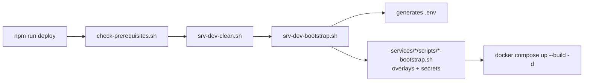
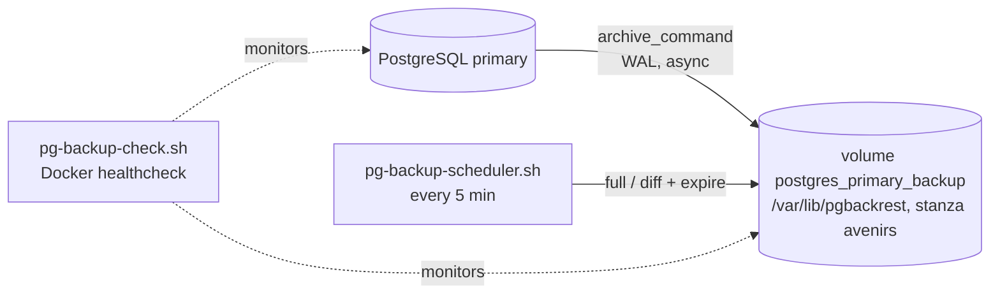

## Introduction

[srv-dev](https://github.com/avenirs-esr/srv-dev){:target="_blank"} is the orchestration repository of the platform: it starts the whole stack with [Docker Compose](https://docs.docker.com/compose/){:target="_blank"}. The same repository serves the local machine, `dev`, `qualif` and `recette`.

Application architecture: [Overview](../arch-overview/).

## Organization

- The root `docker-compose.yml` includes (`include:`) one compose file per service; all containers share the external network `avenirs-network`.
- `services/<service>/` holds each service's configuration, overlays and `scripts/<service>-bootstrap.sh`.
- Application services are **Git submodules**: `avenirs-portfolio/{avenirs-portfolio-api, -back-office, -interoperability, -security, avenirs-cofolio-client}`, plus `apisix-docker`, `apisix-dashboard` and `cas-overlay-template`.

## Startup



The bootstrap replaces the `__SEC_*__` placeholders of the overlays with the values of `.secrets.env`.

| Command (in srv-dev) | Effect |
|---|---|
| `npm run deploy` | Deploy, keeping existing `.env` files |
| `npm run deploy:overwrite` | Same, regenerating the `.env` files |
| `npm run reset` | Reset the environment |
| `npm run db:update-all` | Liquibase migrations for api, back-office, interoperability and security |
| `npm run db:reset-all` | Recreate the databases, then replay Liquibase |
| `npm run ls-containers` | List containers |

Local installation: see the [README](https://github.com/avenirs-esr/srv-dev/tree/main#readme){:target="_blank"}.

## APISIX routes

Routes are **generated** from the backends' OpenAPI by `services/apisix/scripts/initialization/generate-routes-from-open-api.sh`:

- one route per `operationId` (a new endpoint must have one);
- `{param}` becomes `*`;
- no per-service prefix;
- `init-routes.sh` deletes all routes before recreating them.

## Database backup and restore

PostgreSQL is backed up with **pgBackRest**: physical backups plus continuous WAL archiving, which allows **point-in-time recovery (PITR)**. Everything lives in `services/postgresql` (`README-backup.md`, `avenirs-postgresql-overlay/backup/`). Only the primary is backed up.



### How it works

| Aspect | Behavior |
|---|---|
| Image | `backup/Dockerfile` adds `pgbackrest` to `postgres:${POSTGRES_VERSION}` (`avenirs-postgres-pgbackrest`); `entrypoint-backup.sh` fixes permissions, starts the scheduler in the background, then hands over to the official entrypoint |
| WAL archiving | `archive_mode = on`, `archive_command = 'pgbackrest --stanza=avenirs archive-push %p \|\| exit 1'`, `archive_timeout = 15min` (a WAL is forced at least every 15 min), `archive-async=y` |
| Safeguard | `max_slot_wal_keep_size = 5GB`: an inactive replication slot cannot fill the disk |
| Startup | The scheduler waits for PostgreSQL, creates the stanza if missing, runs `check`, then an initial **full** backup if none exists |
| Schedule | Checked every 5 min. At `BACKUP_HOUR=02` (UTC): **full** on Sunday (`BACKUP_FULL_DAY=7`), **diff** the other days. `expire` runs after each successful backup |
| Retention | `repo1-retention-full=7` and `repo1-retention-diff=7`, `type=time`: 7 rolling days, with the WAL they need. Compression `zst` |
| Logs | `/var/log/pgbackrest/scheduler.log` (errors and backups only). Inactive replication slots are reported there |

### Monitoring

`pg-backup-check.sh` is the container healthcheck. The container becomes `unhealthy` when:

- PostgreSQL does not answer;
- WAL archiving fails (`last_failed_time > last_archived_time` in `pg_stat_archiver`);
- the last backup is older than 36 h (`MAX_BACKUP_AGE_H`);
- the repository disk is above 85 %.

The container has `restart: always`.

### Restore a previous version

```bash
npm run pg:restore:stop
npm run pg:restore -- "2026-10-13 14:15:00+02"   # no argument: latest archived state
npm run pg:restore:start
```

`pg-restore.sh` runs `pgbackrest --delta restore`; with a time it adds `--type=time --target=<time> --target-action=promote`. It uses a one-off container (`docker compose run --rm --no-deps --entrypoint ""`) on the data volume, with no scheduler and no server.

Before restoring:

1. **The restore overwrites the current database**: everything after the chosen time is lost. Stop the applications first, restart them afterwards.
2. Give the time **with its UTC offset** (`+02` in summer, `+01` in winter). Logs are in UTC.
3. The time must be after the oldest backup and before the last archived WAL (check with `npm run pg:backup:info`).
4. To target "now", force the archiving first with `SELECT pg_switch_wal();`, otherwise the error is `recovery ended before configured recovery target`.

Check after restoring:

```bash
docker logs --tail 60 avenirs-pgsql-primary 2>&1 | grep -Ei 'recovery|timeline|ready to accept|fatal'
npm run pg:backup:now     # new full backup on the new timeline
npm run pg:backup:info    # status: ok
```

A new timeline after a restore is normal.

### Commands

| Command | Effect |
|---|---|
| `npm run pg:backup:info` | Backups and WAL range available |
| `npm run pg:backup:now` | Immediate full backup |
| `npm run pg:backup:check` | pgBackRest check |
| `npm run pg:wal:checkpoint` | Force a checkpoint / WAL archiving |
| `npm run pg:slots` | Replication slots |
| `npm run pg:restore:stop` / `pg:restore` / `pg:restore:start` | Restore procedure |

## Deployment on the VMs

On the servers, this repository is not run by hand: it is driven by [avenirs-deployment](../deployment/), itself called by the [GitHub workflows](../workflows/).

## Containers architecture

 {% include img.html
        src="assets/images/docker-containers.svg"
        alt="Dockers containers"
        width="100%"
        caption="Architecture: containers and services"
    %}
