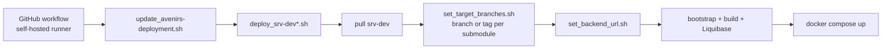
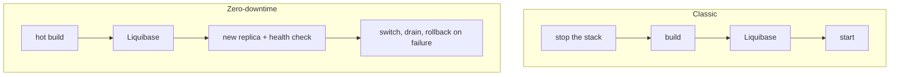
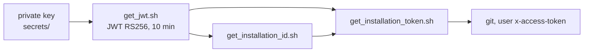

[`avenirs-deployment`](https://github.com/avenirs-esr/avenirs-deployment){:target="_blank"} is a **Bash** orchestrator with no application code. On each VM it lives next to `srv-dev` in `/opt/avenirs-dev/` and: updates srv-dev, puts each submodule on the right branch or tag, injects secrets and the backend URL, builds, runs Liquibase migrations and (re)starts the containers.

Almost everything is delegated to the [srv-dev](../srv-dev/) scripts: see the [contract](#contract-with-srv-dev).

## Table of contents

- [How it works](#how-it-works)
- [Configuration](#configuration)
- [Deployment strategies](#deployment-strategies)
- [GitHub authentication](#github-authentication)
- [Contract with srv-dev](#contract-with-srv-dev)
- [Commands](#commands)

## How it works



| File | Role |
|---|---|
| `conf/deployment.conf` | Per-VM configuration, **gitignored** (template: `deployment.conf.sample`) |
| `conf/tags.conf` | Tags per environment. No script reads it: human reference |
| `secrets/` | `.secrets.env` and the GitHub App private key, gitignored |
| `scripts/deploy_srv-dev.sh` | Classic deployment (full downtime) |
| `scripts/deploy_srv-dev_zero-downtime.sh` | Rolling update per replica with health checks and rollback |
| `scripts/set_target_branches.sh` | Puts srv-dev and each submodule on the ref from `deployment.conf` |
| `scripts/set_backend_url.sh` | Computes the `/apim` URL for `TARGET` |
| `scripts/clone_srv-dev.sh`, `pull_srv-dev.sh` | First clone, srv-dev update |
| `scripts/cleanup_docker.sh` | Purges images older than 168 h, build cache beyond 5 GB, orphan volumes (`--dry-run` available) |
| `scripts/get_jwt.sh`, `get_installation_*.sh` | GitHub App authentication |

## Configuration

Format `KEY = value`; empty lines and `#` comments are ignored.

| Key | Values | Default if missing | Effect |
|---|---|---|---|
| `TARGET` | local, dev, qualif, recette | local | Backend URL `https://<target>.avenirs-esr.fr/apim` |
| `OVERWRITE_ENV_FILE` | true, false | true | true: `.env` files and backend URL regenerated. false: only missing `.env` files are created |
| `RESET_DB` | true, false | **true** | true: `db:reset-all` then seeds. false: `db:update-all` (Liquibase only) |
| `<path> = <ref>` | branch or tag | — | Ref of each repository. Key = submodule path relative to srv-dev; `srv-dev` for the root repository |

> A missing `RESET_DB` key defaults to `true` and **wipes the database**. Make sure it is present in the `deployment.conf` of every VM.

Versions: `X.Y.Z-qa` for qualif, `X.Y.Z-rc` for recette, branches for dev ([tagging strategy](../devops/#tagging-strategy)). Keys differ between `tags.conf` (repository name) and `deployment.conf` (submodule path). If the `srv-dev` key is missing, no submodule is positioned.

## Deployment strategies



| | Classic | Zero-downtime |
|---|---|---|
| Downtime | full build + boot | ~0 on api, back-office, security, cofolio-client |
| `RESET_DB=true` | yes | refused |
| Automatic rollback | no | yes, per service |
| srv-dev dependency | npm scripts | shell scripts + `docker-compose.zero-downtime.yml` (`develop` branch only) |

- With zero-downtime, **Liquibase runs while the old version is serving**: migrations must be backward compatible (add first, remove in a later release).
- The zero-downtime script takes a `flock` lock and falls back to the classic script when there is no installation. The classic script does not take the lock.
- Zero-downtime requires Docker Compose ≥ 2.24.4.

## GitHub authentication

GitHub access goes through the `avenirs-deploy-app` GitHub App. The token is given to git by a temporary `GIT_ASKPASS` script (never in the URL or `.git/config`).



## Contract with srv-dev

This repository depends on scripts, files and container names defined in srv-dev. **Any rename on the srv-dev side breaks the deployment.**

| Called from avenirs-deployment | Defined in srv-dev |
|---|---|
| `npm run clean` / `clean:keep-overlay` | `docker compose down`, then `srv-dev-clean.sh -vv [-keep-overlay]` |
| `npm run deploy` / `deploy:overwrite` | `check-prerequisites.sh` → `srv-dev-clean.sh` → `srv-dev-bootstrap.sh [-overwrite]` → `docker compose up --build -d` |
| `npm run db:reset-all` / `db:update-all` | `psql` on the host, then `mvn liquibase:update` for api, back-office, interoperability and security |
| `check-prerequisites.sh`, `srv-dev-clean.sh`, `srv-dev-bootstrap.sh` | Called directly by zero-downtime to avoid the `compose down` |
| `docker-compose.zero-downtime.yml` | Removes `container_name` and `ports`, adds healthchecks and Spring graceful shutdown (45 s) |
| Hard-coded container names | `avenirs-portfolio-api`, `avenirs-portfolio-back-office`, `avenirs-apache`, `avenirs-apisix-api`, `avenirs-apisix-init`, `avenirs-openapi-merge` |
| Files written in srv-dev | `.secrets.env` (copied), `backend-url.generated.env` |

Host prerequisites: jq, openssl, git, curl, flock, Node (nvm), Java and Maven (sdkman, for Liquibase), Docker Compose, user in the `docker` group.

## Commands

On a VM, from `/opt/avenirs-dev` as user `srvdev`:

```bash
# Developer setup (git hooks: no direct commit on main / develop)
bash setup-git-hooks.sh

# Update this repository
./avenirs-deployment/scripts/update_avenirs-deployment.sh

# First time: create the configuration
cp avenirs-deployment/conf/deployment.conf.sample avenirs-deployment/conf/deployment.conf

# Classic deployment
./avenirs-deployment/scripts/deploy_srv-dev.sh

# Rolling update (RESET_DB=false)
bash avenirs-deployment/scripts/deploy_srv-dev_zero-downtime.sh

# Docker cleanup
bash avenirs-deployment/scripts/cleanup_docker.sh --dry-run
```
