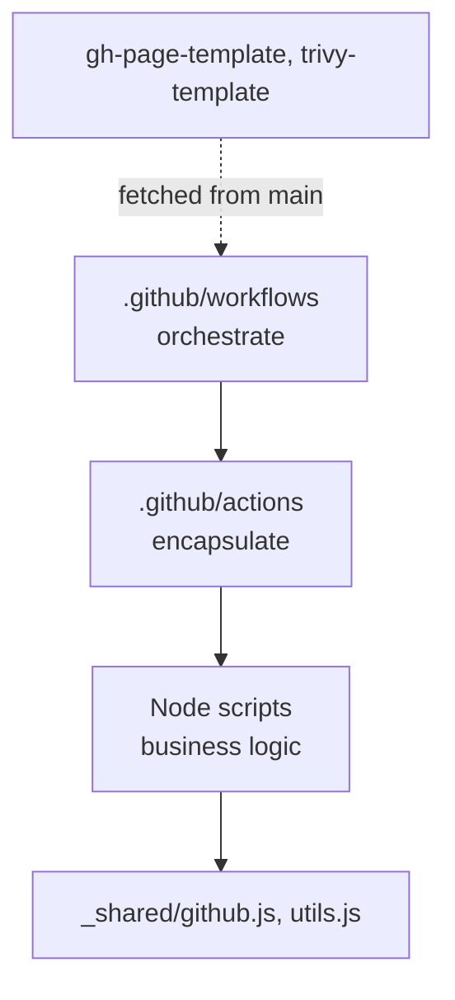
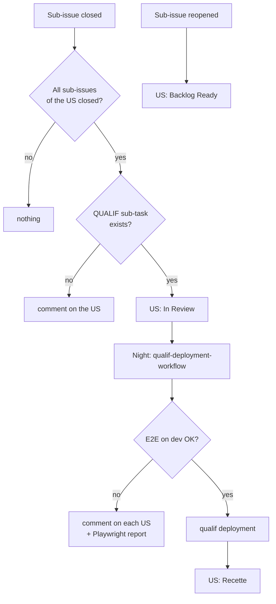
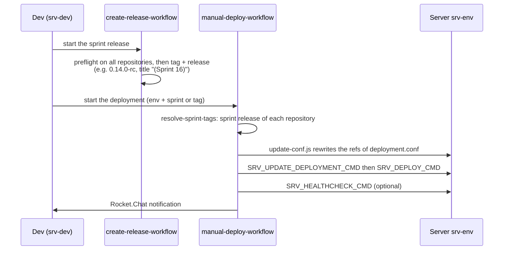

[`avenirs-workflows`](https://github.com/avenirs-esr/avenirs-workflows){:target="_blank"} centralizes the organization's CI/CD: **21 reusable workflows** (`on: workflow_call`) and **50 composite actions**. It contains no application code.

Repositories call it like this:

```yaml
uses: avenirs-esr/avenirs-workflows/.github/workflows/<workflow>.yaml@main
secrets: inherit   # several workflows read secrets they do not declare
```

> Everything is consumed as `@main` and the repository has no tag: every merge on `main` reaches all consumers (Java API, cofolio client, DSAV, srv-dev) immediately.

## Table of contents

- [Structure](#structure)
- [Workflows by domain](#workflows-by-domain)
- [Deployments](#deployments)
- [User Story lifecycle](#user-story-lifecycle)
- [Release and deploy chain](#release-and-deploy-chain)
- [Required configuration](#required-configuration)

## Structure



- Actions are **composite**; the logic lives in Node scripts without npm dependencies (native `fetch`, Node 26 installed by `setup-node`).
- Inputs through environment variables, outputs in `$GITHUB_OUTPUT`.
- GitHub App authentication (`github-app-token`): one main App, one for the wiki, one for DSAV.
- Rocket.Chat notifications (`rocket-chat-notify`), reports published on the `gh-pages` branch.
- Deployments run on **self-hosted** runners (labels `srv-dev`, `srv-qualif`, `srv-recette`): see [Devops](../devops/#self-hosted-runners).

## Workflows by domain

| Domain | Workflows |
|---|---|
| Backend CI | `common-backend-workflow`: lint (google-java-format), Trivy scan (fails on CRITICAL), tests + JaCoCo in parallel, then publication on gh-pages |
| Frontend CI | `frontend-quality-check-workflow` (typecheck, lint, Vitest on 4 shards, coverage thresholds), `a11y-test-and-deploy-reports-workflow`, `pr-e2e-frontend-workflow` (Playwright, 4 shards), `pr-e2e-cleanup-workflow`, `frontend-deploy-docs-workflow` (VitePress + Storybook), `only-develop-to-main-workflow` |
| npm (DSAV) | `release-version-to-npm-workflow` (version + tag), `auto-deploy-to-npm-workflow` (`npm publish --provenance`) |
| Release | `create-release-workflow`: same tag on the `develop` HEAD of every repository in `RELEASE_REPOSITORIES` |
| Deployment | `manual-deploy-workflow`, `qualif-deployment-workflow` (nightly), `e2e-tests-workflow` |
| Project V2 | `check-us-completion-workflow`, `reopen-us-workflow`, `sub-issue-inherit-parent-fields-workflow`, `bug-task-creation-workflow` |
| Wiki | `update-wiki-epic-us-rules-workflow`, `update-wiki-from-project-workflow` |

## Deployments

| Environment | Trigger | Workflow |
|---|---|---|
| dev | Merge into `develop`: a workflow in each repository calls the deployment workflow of avenirs-workflows | `manual-deploy-workflow` |
| qualif | Nightly, if User Stories are "In Review" | `qualif-deployment-workflow` |
| recette | Manual only | `create-release-workflow` then `manual-deploy-workflow` |

On the server, the deployment itself is done by [avenirs-deployment](../deployment/).

## User Story lifecycle



Statuses are read ignoring case and emojis. `US_ISSUE_TYPE` defines the accepted issue types; `QUALIF_EXEMPT_ISSUE_TYPES` exempts some types from the QUALIF sub-task.

## Release and deploy chain

A sprint release is done in two calls from srv-dev:



- The preflight checks every repository before any write; tags are never moved; the workflow can be re-run.
- A repository without a matching release makes the run fail **before** any change.
- One deployment at a time per environment (`concurrency` without cancellation).
- The announced version is the tag of the first resolved repository: the chain assumes the same tag everywhere.

## Required configuration

Organization or environment (`dev`, `qualif`, `recette`) variables and secrets in GitHub.

| Type | Usage | Names |
|---|---|---|
| Variables | Project V2 | `ORG`, `COFOLIO_PROJECT_NUMBER`, `COFOLIO_PROJECT_URL`, `US_ISSUE_TYPE`, `QUALIF_EXEMPT_ISSUE_TYPES`, `*_STATUS_NAME` |
| Variables | Release and deployment | `RELEASE_REPOSITORIES`, `DEPLOY_REPOSITORIES`, `JAVA_VERSION`, `MAVEN_VERSION`, `CONF_PATH`, `CONF_FILE`, `SRV_HEALTHCHECK_CMD`, `SRV_DEV_LABEL`, `SRV_QUALIF_LABEL` |
| Variables | E2E, notifications | `SEEDING_ENDPOINT_URL`, `DEV_COFOLIO_URL`, `RECETTE_COFOLIO_URL`, `ROCKET_CHAT_NOTIFICATION_CANAL`, `ROCKET_CHAT_RECETTE_CHANNEL` |
| Secrets | By category | GitHub Apps, Rocket.Chat, server commands and paths, E2E dataset access. The list is in the `avenirs-workflows` repository |

Self-hosted runner prerequisites: SDKMAN (Java, Maven), nvm (Node 26, installed at each deployment), Docker Compose, `sudo` for `apt-get` (used by `rocket-chat-notify`).
